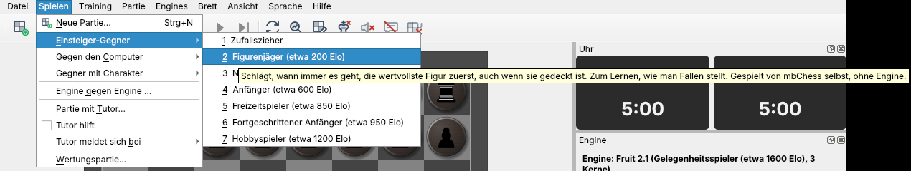
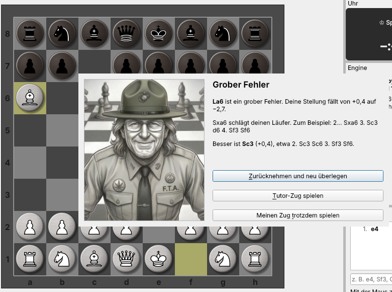
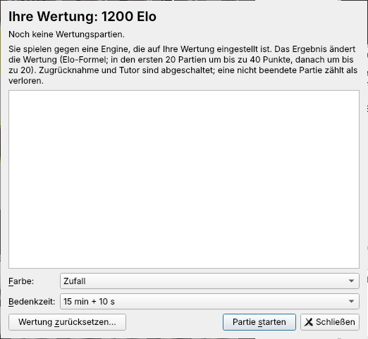
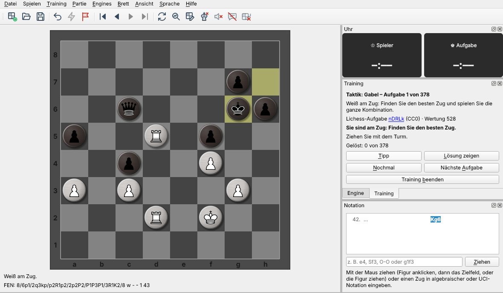
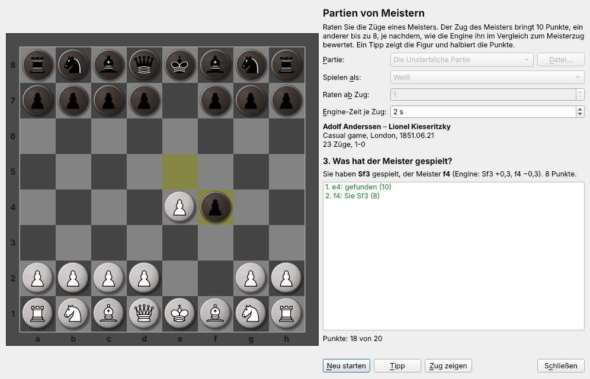
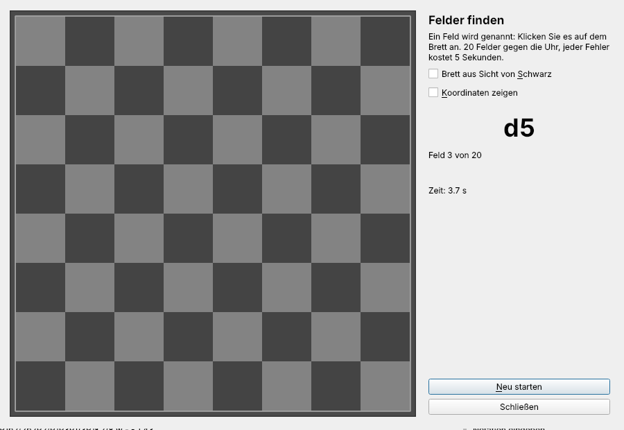
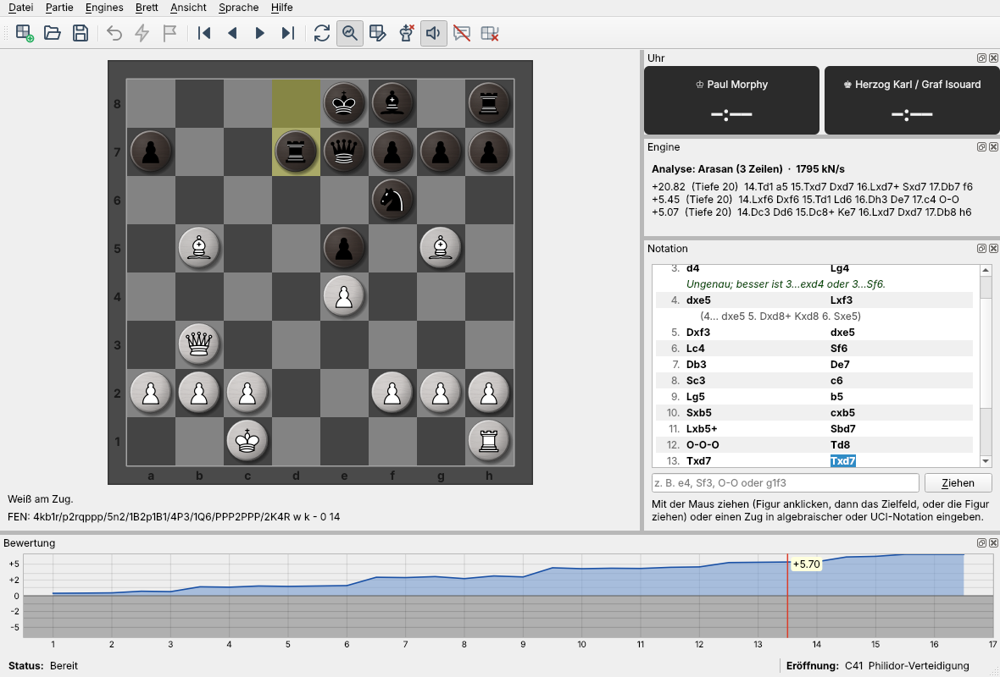
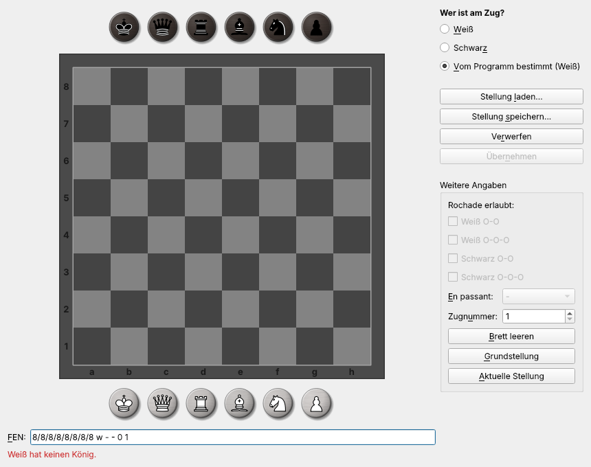
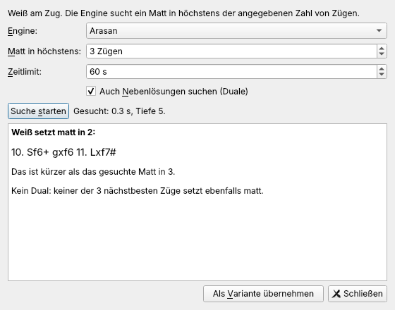
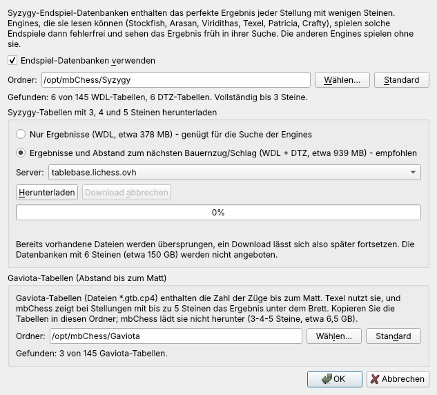

# Willkommen bei mbChess

mbChess ist ein freies Schachprogramm für Windows, Linux und macOS (Android folgt). Sie
können damit gegen starke Schach-Engines und gegen Gegner jeder Spielstärke spielen, mit einem
Tutor an Ihrer Seite üben, Matt-, Taktik- und Endspielaufgaben lösen, Eröffnungen und das
Brettsehen trainieren, Partien nachspielen und analysieren, Engines gegeneinander antreten
lassen und mit einem elektronischen DGT-Brett spielen.

Das Wichtigste in Kürze:

- **Spielen** gegen eine Engine, gegen einen Menschen am selben Brett oder Engine gegen Engine
  zuschauen, mit Schachuhr, einstellbarer Spielstärke, Eröffnungsbuch und Chessbooks.
- **Fertige Gegner** im Menü Spielen: vom „Zufallszieher“ für die ersten Schritte über
  Vereinsspieler und Meister bis zu Gegnern mit eigenem Charakter.
- **Partie mit Tutor**: Ein Tutor schaut sich jeden Ihrer Züge an und meldet sich, bevor ein
  schlechter Zug gespielt wird.
- **Wertungspartien** mit einer eigenen Elo-Zahl, die mit Ihnen wächst.
- **Training**: Matt in 1 bis 3, über 2.300 Taktikaufgaben nach 22 Themen, Eröffnungs-Repertoire,
  Partien von Meistern nachraten, Durchhalten gegen die stärkste Engine, Endspiele und
  Übungen für Brett und Gedächtnis.
- **Mitgelieferte Engines**: Stockfish, Arasan, Fruit, Toga II, Glaurung, GNU Chess,
  Viridithas, Texel, Patricia und die Tarrasch Toy Engine. Weitere UCI-Engines lassen sich
  hinzufügen.
- **Analyse** mit einer Engine, Bewertungsgraph, Varianten und Kommentaren.
- **Partiedatenbanken** im PGN-Format, auch mit zehntausenden Partien.
- **Brett-Editor** und **Mattsuche**.
- **Engine-Benchmark**: ein Rundenturnier der Engines unter gleichen Bedingungen.
- **Endspiel-Datenbanken**: Syzygy zum Herunterladen, Gaviota mit Matt-Abstand in der Analyse.
- **DGT-Bretter** über USB oder Bluetooth.
- Hunderte **Bretter und Figurensätze**, Zuggeräusche und **Zugansagen** auf Deutsch oder Englisch.

mbChess ist freie Software unter der GNU General Public License, Version 3 oder später.
Es wird ohne jede Gewährleistung geliefert.

# Installation und Programmstart

## Windows

Starten Sie den Installer `mbChess-<Version>-de-setup.exe` (Deutsch) oder
`mbChess-<Version>-en-setup.exe` (Englisch). Der Assistent schlägt den Ordner `C:\mbChess`
vor und bietet diese Komponenten an:

| Komponente | Inhalt | Vorgabe |
| --- | --- | --- |
| mbChess | das Programm mit Hilfe (CHM), Brettern, Figuren, Klängen und Trainingsaufgaben | immer |
| UCI-Schach-Engines | die mitgelieferten Engines, jede einzeln abwählbar | an |
| Sprachaufnahme | Programm zum Aufnehmen eigener Zugansagen | aus |
| Handbuch (PDF) | dieses Handbuch als PDF-Datei | aus |

Eine vorhandene Installation wird dabei ersetzt; Ihre Einstellungen, Wertungen und
Trainingsfortschritte bleiben erhalten. Deinstallieren können Sie mbChess über
„Einstellungen → Apps“ oder über „mbChess deinstallieren“ im Startmenü. Dort finden Sie auch
die „mbChess-Hilfe“.

## Linux und macOS

Für Debian, Ubuntu und davon abgeleitete Systeme gibt es auf der Download-Seite ein
Debian-Paket (`mbchess_<Version>_amd64.deb`). Installieren Sie es im Terminal mit

    sudo apt install ./mbchess_<Version>_amd64.deb

`apt` holt dabei die nötigen Qt-6-Bibliotheken gleich mit (Debian 12 und neuer, Ubuntu 24.04
und neuer). Das Programm liegt danach mit den Engines, der Sprachaufnahme, den Handbüchern
und den Ordnern `Openings`, `Chessbooks`, `Syzygy`, `Gaviota` und `Training` in `/opt/mbChess`;
diese Ordner dürfen alle Benutzer beschreiben, Sie können dort also ohne Administratorrechte
Bücher und Partiesammlungen ablegen. mbChess erscheint im Anwendungsmenü unter „Spiele“ und
lässt sich im Terminal mit `mbchess` starten (die Sprachaufnahme mit
`mbchess-voicerecorder`). Eine neue Version installieren Sie auf dieselbe Weise über die alte;
entfernen können Sie mbChess mit `sudo apt remove mbchess`. Einstellungen und Partien bleiben
dabei erhalten.

Für andere Linux-Systeme gibt es ein Archiv (`.tar.gz`) mit dem fertigen Programm und den
Engines; es braucht ebenfalls die Qt-6-Bibliotheken des Systems. Entpacken Sie es an einen
beliebigen Ort und starten Sie `mbchess` im entpackten Ordner `mbChess-<Version>`.

Alternativ bauen Sie mbChess aus dem Quelltext (Qt 6.4 oder neuer, unter macOS Catalina
Qt 5.15). Die Anleitung steht in der Datei `README.md` des Quelltexts. Unter Debian und Ubuntu
installiert `sh tools/install-build-deps.sh` vorher alle Pakete, die zum Bauen fehlen. Das Ergebnis liegt im
Ordner `bin` des Build-Ordners.

## Testversionen für Beta-Tester

Solange mbChess noch entwickelt wird, sind die verteilten Versionen Testversionen. Beim ersten
Start erscheint ein Hinweis, dass es sich um eine Entwicklerversion handelt, und bis wann sie
läuft: Jede Version läuft **sechs Wochen** ab dem ersten Start. In der letzten Woche erinnert
mbChess bei jedem Start daran, bald die aktuelle Version zu installieren; danach zeigt es nur
noch, wo es die neue Version gibt, und beendet sich.

Eine neue Version läuft wieder volle sechs Wochen. Einstellungen, Partien, Wertungen und
Engines bleiben beim Wechsel erhalten. **Hilfe → Über mbChess** zeigt, bis wann Ihre Version
läuft.

## Der Startbildschirm

Beim Start zeigt mbChess einen Startbildschirm mit Versionsnummer, dem gerade geladenen
Teil (Einstellungen, Bretter und Figuren, Engines und Bücher, Suche nach einem DGT-Brett)
und einem Fortschrittsbalken. Sie schalten ihn mit **Ansicht → Startbildschirm anzeigen**
ab und wieder ein.

## Kommandozeile

| Aufruf | Wirkung |
| --- | --- |
| `mbchess partie.pgn` | öffnet die PGN-Datei |
| `mbchess --fen "<FEN>"` | stellt die Stellung aus der FEN auf das Brett |

# Das Hauptfenster

Das Hauptfenster besteht aus dem Brett in der Mitte und mehreren Fenstern rundherum. Jedes
dieser Fenster lässt sich verschieben, an einen anderen Rand andocken, frei schweben lassen
oder schließen. Im Menü **Ansicht** schalten Sie sie wieder ein; **Ansicht →
Fensteranordnung zurücksetzen** stellt die ursprüngliche Anordnung her. Größe, Position und
Anordnung speichert mbChess selbst.

| Fenster | Inhalt |
| --- | --- |
| **Brett** | die Stellung; darunter der Zustand der Partie und die FEN der Stellung |
| **Uhr** | Namen der Spieler und die Bedenkzeit; die Seite am Zug ist hervorgehoben |
| **Engine** | was die Engine gerade rechnet: Tiefe, Bewertung, Hauptvariante, Geschwindigkeit |
| **Training** | Aufgabe, Hinweise und Knöpfe einer Trainingsaufgabe (als Karteireiter neben „Engine“) |
| **Notation** | die Züge der Partie mit Varianten und Kommentaren, darunter die Zugeingabe |
| **Bewertung** | der Bewertungsgraph der Partie |
| **Partien** | die Partienliste einer geöffneten Datenbank |

## Die Menüs

| Menü | Inhalt |
| --- | --- |
| **Datei** | Partien öffnen und speichern, Datenbank blättern, FEN, Benchmarks, Beenden |
| **Spielen** | Neue Partie, fertige Gegner, Engine gegen Engine, Partie mit Tutor, Wertungspartie |
| **Training** | Matt finden, Taktik, Eröffnungen, Partien von Meistern, Durchhalten, Endspiele, Brett und Gedächtnis, Mattsuche |
| **Partie** | Zug zurücknehmen, Sofort ziehen, Aufgeben, durch die Partie blättern, Stellung aufbauen |
| **Engines** | Engine-Analyse, Analyse-Engine und -Zeilen, Engines verwalten, Endspiel-Datenbanken |
| **Brett** | Brett drehen, Koordinaten, Brettoptik, Figuren, Klänge, Stimme, DGT-Brett |
| **Ansicht** | Fenster ein- und ausblenden, Fensteranordnung, Fenster-Design, Startbildschirm |
| **Sprache** | Deutsch oder English |
| **Hilfe** | dieses Handbuch (F1), Über mbChess, Über Qt |

## Die Statusleiste

Die Statusleiste am unteren Rand ist in Abschnitte geteilt:

- **Status:** allgemeine Meldungen, etwa „Partie gespeichert“, „Buchzug“ oder „Der Tutor
  schaut sich deinen Zug an …“. Ohne Meldung steht hier „Bereit“.
- **Chessbook:** der Fortschritt beim Einlesen eines Chessbooks (nur während des Lesens).
- **Eröffnung:** der ECO-Code und der Name der Eröffnung, bei deutscher Oberfläche mit
  deutschem Namen. Der Tooltip zeigt den internationalen Namen.
- **Benchmark:** Fortschritt eines laufenden Engine-Benchmarks mit Knopf zum Abbrechen.
- **DGT:** der Zustand des DGT-Bretts, etwa „✓ stimmt mit der Partie überein“ oder „bitte Sf6
  auf dem Brett ziehen“.

Ist ein Text zu lang, wird er mit „…“ gekürzt; der Tooltip zeigt ihn vollständig.

## Die Werkzeugleiste

Die Werkzeugleiste enthält von links nach rechts: Neue Partie, Partie öffnen, Partie
speichern, Zug zurücknehmen, Sofort ziehen, Aufgeben, zum Anfang, einen Zug zurück, einen Zug
vor, zum Ende, Brett drehen, Engine-Analyse, Stellung aufbauen, Matt suchen, Zuggeräusche,
Zugansage und DGT-Brett. Die Symbole für Zuggeräusche, Zugansage und DGT-Brett zeigen, ob die
Funktion an oder aus ist.

# Eine Partie spielen

## Neue Partie

**Spielen → Neue Partie** (Strg+N) öffnet den Dialog für eine neue Partie. Schneller geht es
mit den fertigen Gegnern im selben Menü (Kapitel „Das Menü Spielen“).

| Einstellung | Bedeutung |
| --- | --- |
| **Gegner** | Engine (Computer), Mensch (beide Seiten an diesem Brett) oder Engine gegen Engine |
| **Ihre Farbe** | Weiß, Schwarz oder Zufall |
| **Ihr Name** | erscheint an der Uhr und in der gespeicherten PGN |
| **Engine** | der Gegner. „Andere Engine…“ wählt eine Programmdatei, „Verwalten…“ öffnet die Engine-Verwaltung |
| **Spielstärke** | von „Anfänger (etwa 1350 Elo)“ bis „Volle Spielstärke“ |
| **CPU-Kerne**, **Hash-Tabelle** | Rechenleistung und Speicher der Engine |
| **Engine denkt in Ihrer Bedenkzeit mit (Ponder)** | die Engine rechnet schon, während Sie überlegen, und zwar auf den Zug, den sie von Ihnen erwartet. Spielen Sie ihn, antwortet sie schneller und besser. Nur mit voller Spielstärke und bei Engines, die es können (Stockfish, Arasan, Texel, Fruit, Toga II, Glaurung, GNU Chess) |
| **Bedenkzeit** | „Ohne Uhr“ oder eine Bedenkzeit mit Inkrement, zum Beispiel 5 min + 3 s |
| **Immer in Dame umwandeln** | ein Bauer auf der letzten Reihe wird ohne Rückfrage zur Dame |
| **Von der Stellung auf dem Brett aus spielen** | die Partie beginnt mit der aufgebauten Stellung statt mit der Grundstellung |
| **Eröffnungsbuch und Chessbooks** | siehe Kapitel „Eröffnungsbücher und Chessbooks“ |

Bei „Engine gegen Engine“ wählen Sie eine Engine für Weiß und eine für Schwarz; Sie schauen
dann zu.

## Züge eingeben

Sie haben mehrere Möglichkeiten:

- **Klicken**: die Figur anklicken, dann das Zielfeld.
- **Ziehen**: die Figur mit gedrückter Maustaste auf das Zielfeld ziehen.
- **Tippen**: den Zug in das Feld unter der Notation schreiben und Enter drücken, in
  algebraischer Notation (`e4`, `Sf3`, `O-O`, `exd5`, `e8=D`) oder in UCI-Notation (`g1f3`).
  Die englischen Figurenbuchstaben (N, B, R, Q) gehen ebenfalls.
- **DGT-Brett**: den Zug auf dem elektronischen Brett ausführen (Kapitel „DGT-Brett“).

Bei einer Umwandlung fragt mbChess nach der Figur, außer „Immer in Dame umwandeln“ ist an.

## Während der Partie

| Befehl | Taste | Wirkung |
| --- | --- | --- |
| Partie → Zug zurücknehmen | Strg+Z | nimmt Ihren letzten Zug (und den Antwortzug der Engine) zurück |
| Partie → Sofort ziehen! | Leertaste | die Engine soll sofort ziehen |
| Partie → Aufgeben | – | gibt die Partie verloren |
| Brett → Brett drehen | Strg+R | dreht das Brett |

Sie können während der Partie mit den Pfeiltasten zurückblättern. Gezogen wird aber nur am
Ende der Partie; die Ende-Taste bringt Sie zurück.

Die Partie endet mit Matt, Patt, dreifacher Stellungswiederholung, der 50-Züge-Regel,
ungenügendem Material, Zeitüberschreitung oder Aufgabe. Danach wird das Brett zum
Analysebrett: Sie können Züge ausprobieren und die Engine-Analyse einschalten.

Befehle, die eine laufende Partie beenden würden (eine neue Stellung, der Brett-Editor, die
Mattsuche, eine Trainingsaufgabe, ein Benchmark auf dem Brett, das Beenden des Programms),
fragen vorher nach.

# Das Menü Spielen

Das Menü **Spielen** bietet neben „Neue Partie“ fertige Gegner, mit denen eine Partie mit einem
Klick beginnt. Farbe, Bedenkzeit, Ihr Name, Kerne, Hash und Bücher übernimmt mbChess aus den
letzten Einstellungen von „Neue Partie“. Der Tooltip jedes Gegners beschreibt seine Spielweise
und nennt die Engine, die ihn spielt. Fehlt diese Engine, nimmt mbChess eine passende andere;
gibt es gar keine, ist der Gegner ausgegraut.

## Einsteiger-Gegner

Für alle, die Schach gerade lernen oder wieder anfangen. Einsteiger-Gegner spielen ohne Uhr
und ohne Eröffnungsbuch; Sie haben also alle Zeit der Welt.

| Gegner | Stärke | Spielweise |
| --- | --- | --- |
| Zufallszieher | – | spielt irgendeinen regelgerechten Zug; zum Lernen, wie die Figuren ziehen und schlagen |
| Figurenjäger | etwa 200 Elo | schlägt, wann immer es geht, die wertvollste Figur zuerst, auch wenn sie gedeckt ist; zum Lernen, wie man Fallen stellt |
| Neuling | etwa 400 Elo | übersieht oft Drohungen, die nur einen Zug tief sind |
| Anfänger | etwa 600 Elo | schützt meist seine Figuren, übersieht aber Gabeln und Spieße |
| Freizeitspieler | etwa 850 Elo | greift gern an und macht menschliche Fehler |
| Fortgeschrittener Anfänger | etwa 950 Elo | spielt aktiv, verliert ab und zu eine Figur |
| Hobbyspieler | etwa 1200 Elo | solide; Fehler nur in längeren Varianten |

Zufallszieher und Figurenjäger spielt mbChess selbst, ohne Engine. Die übrigen spielen Texel
oder Patricia mit verminderter Stärke. Die Elo-Angaben wurden in Testturnieren gegen Texel
gemessen und sind Richtwerte.

## Gegen den Computer

| Gegner | Stärke |
| --- | --- |
| Gelegenheitsspieler | etwa 1600 Elo: kennt die Grundregeln der Strategie, übersieht aber noch Taktik |
| Vereinsspieler | etwa 1900 Elo: ein solider Vereinsspieler |
| Experte | etwa 2200 Elo: ein starker Vereinsspieler |
| Meister | etwa 2500 Elo: spielt wie ein Meister |
| Volle Spielstärke | die Engine mit voller Stärke: weit stärker als jeder Mensch |

Diese Gegner spielt Stockfish (ersatzweise Arasan oder Texel) mit begrenzter Spielstärke, mit
der Bedenkzeit und den Büchern aus „Neue Partie“.

## Gegner mit Charakter

| Gegner | Stärke | Spielweise |
| --- | --- | --- |
| Angriffsspieler | etwa 1800 Elo | spielt auf Königsangriff und opfert dafür Material (Patricia) |
| Positionsspieler | etwa 1800 Elo | spielt ruhig, verbessert seine Figuren und wartet auf Ihre Fehler (Arasan) |
| Materialist | etwa 1800 Elo | schnappt sich jeden Bauern, den er bekommen kann, und verteidigt ihn (Texel) |
| Klassiker | etwa 2600 Elo | eine klassische Engine der 2000er-Jahre ohne neuronales Netz, mit voller Stärke: klares, prinzipientreues Schach (Fruit, Toga II oder Glaurung) |

## Engine gegen Engine

**Spielen → Engine gegen Engine …** öffnet „Neue Partie“ mit dem Gegner „Engine gegen Engine“.
Wählen Sie die beiden Engines und die Bedenkzeit und schauen Sie zu. Für viele Partien unter
gleichen Bedingungen gibt es den Engine-Benchmark (Kapitel „Engine-Benchmark“).

## Partie mit Tutor

Der Tutor ist ein freundlicher, aber ehrlicher Schachlehrer. In Partien gegen den Computer
schaut er sich jeden Ihrer Züge an, **bevor** er gespielt wird. Ist der Zug schlecht, meldet er
sich mit einem Bild, einer Erklärung und einem besseren Vorschlag. Der Tutor spricht Sie mit
„du“ an.

- **Spielen → Partie mit Tutor …** schaltet den Tutor ein und öffnet „Neue Partie“.
- **Spielen → Tutor hilft** schaltet ihn für alle Partien gegen den Computer ein und aus, auch
  für die fertigen Gegner.
- **Spielen → Tutor meldet sich bei** legt fest, wie streng er ist: bei **Ungenauigkeiten**,
  bei **Fehlern** (Vorgabe) oder **nur bei groben Fehlern**.

Der Tutor rechnet mit der Analyse-Engine (**Engines → Analyse-Engine**). Während er
nachdenkt, steht Ihr Zug schon auf dem Brett, und die Statusleiste meldet „Der Tutor schaut
sich deinen Zug an …“. Er beurteilt einen Zug danach, wie stark Ihre Gewinnchancen sinken:

| Einstufung | Gewinnchance sinkt um |
| --- | --- |
| Ungenauigkeit | mindestens 5 Prozentpunkte |
| Fehler | mindestens 10 Prozentpunkte |
| Grober Fehler | mindestens 15 Prozentpunkte |
| Ganz grober Fehler | mindestens 35 Prozentpunkte |

Als ganz grober Fehler gilt außerdem jeder Fehler, der 6 Bauerneinheiten oder mehr kostet (etwa die
Dame) oder dem Gegner ein Matt erlaubt, auch wenn die Stellung schon vorher verloren oder
noch klar gewonnen war.

Das Fenster des Tutors nennt den Zug und seine Einstufung, was danach droht (etwa „Danach setzt
dich der Gegner matt“ oder welche Figur verloren geht), wie die Bewertung fällt, und einen
besseren Zug mit einer Beispielvariante. Bei einem ganz groben Fehler zeigt er ein anderes Bild
und fragt: „Hast du gekifft?!“ Sie haben drei Möglichkeiten:

- **Zurücknehmen und neu überlegen**: Ihr Zug wird nicht gespielt; Sie ziehen noch einmal.
- **Tutor-Zug spielen**: der Vorschlag des Tutors wird gespielt.
- **Meinen Zug trotzdem spielen**: Ihr Zug bleibt, die Partie geht weiter.

Ein Zug, den der Tutor nicht beanstandet, wird ohne Rückfrage gespielt. In Trainingsaufgaben
und Wertungspartien ist der Tutor aus.

## Wertungspartie

In Wertungspartien erspielen Sie sich eine eigene **mbChess-Elo-Zahl**. **Spielen →
Wertungspartie …** zeigt Ihre Wertung, die Bilanz (gewonnen, remis, verloren) und die letzten
Wertungspartien. Wählen Sie Farbe und Bedenkzeit und klicken Sie **Partie starten**.

- Sie beginnen mit **1200 Elo**. Ihr Gegner ist eine Engine (bevorzugt Texel), die genau auf
  Ihre aktuelle Wertung eingestellt ist.
- Nach der Partie ändert sich die Wertung nach der Elo-Formel: in den ersten 20 Partien um bis
  zu 40 Punkte, danach um bis zu 20.
- Unter 1600 Elo spielt die Engine ohne Eröffnungsbuch.
- Zugrücknahme und Tutor sind abgeschaltet.
- Eine nicht beendete Partie (etwa durch eine neue Partie oder das Beenden des Programms)
  zählt als verloren.

**Wertung zurücksetzen …** beginnt wieder mit 1200 Elo und vergisst alle Wertungspartien.

# Das Menü Training

Im Menü **Training** finden Sie Aufgaben, mit denen Sie gezielt besser werden. Die meisten
laufen auf dem Hauptbrett: Eine Trainingsaufgabe beendet daher eine laufende Partie (mbChess
fragt vorher). „Partien von Meistern“ und „Brett und Gedächtnis“ öffnen ein eigenes Fenster und
lassen die Partie auf dem Hauptbrett in Ruhe.

Während einer Aufgabe hilft keine Engine: Die Engine-Analyse wird abgeschaltet. Falsche Züge
nimmt mbChess gar nicht erst an, sondern sagt, warum der Zug nicht passt; Sie versuchen es
einfach noch einmal.

## Das Trainingsfenster

Zu jeder Aufgabe auf dem Hauptbrett erscheint das Fenster **Training** (als Karteireiter neben
„Engine“). Es zeigt den Titel der Aufgabe (etwa „Matt in 2 – Aufgabe 15 von 719“), die
Aufgabe selbst, die Herkunft (etwa eine Lichess-Aufgabe mit Link), Meldungen zu Ihren Zügen
in Grün (gelöst) oder Rot (gescheitert) und Ihren Fortschritt.

| Knopf | Wirkung |
| --- | --- |
| **Tipp** | ein Hinweis, etwa „Ziehen Sie mit dem Springer. Der erste Zug gibt Schach.“ |
| **Lösung zeigen** | zeigt die Lösung (nur bei Matt- und Taktikaufgaben) |
| **Nochmal** | beginnt dieselbe Aufgabe von vorn |
| **Nächste Aufgabe** / **Neue Stellung** / **Neue Partie** | die nächste Aufgabe derselben Art |
| **Training beenden** | beendet die Aufgabe; das Brett wird zum Analysebrett |

Wer einen Tipp braucht oder einen Fehler macht, löst die Aufgabe trotzdem, aber sie zählt nicht
als gelöst und kommt später noch einmal. Den Fortschritt (gelöste Aufgaben, Bestzeiten,
Rekorde) merkt sich mbChess; die Menüs zeigen ihn hinter jedem Eintrag, etwa „Gabel (3 von
378 gelöst)“. Jede Trainingsart hat einen Eintrag **Fortschritt zurücksetzen …** (oder
„Ergebnisse“, „Rekorde zurücksetzen …“).

## Matt finden

**Training → Matt finden** bietet **Matt in 1**, **Matt in 2** und **Matt in 3** mit je rund
700 Aufgaben aus der freien Aufgabendatenbank von lichess.org (CC0) und eigenen Aufgaben von
mbChess. Die Aufgaben kommen von leicht nach schwer.

Bei den Lichess-Aufgaben macht zuerst der Gegner einen Zug; achten Sie darauf, dann finden Sie
das Matt. Der Gegner verteidigt sich danach immer mit dem Zug, der das Matt am längsten
hinauszögert. mbChess rechnet jede Stellung selbst exakt nach: Jeder Zug, der in der
verbleibenden Zugzahl matt setzt, zählt, auch wenn er nicht in der Lösung steht. Ein Zug, der
nicht rechtzeitig matt setzt, wird abgelehnt („Sf7 setzt nicht rechtzeitig matt“).

## Taktik

**Training → Taktik** enthält über 2.300 Aufgaben von lichess.org (CC0), nach Themen sortiert:

| Gruppe | Themen |
| --- | --- |
| Grundmotive | Ungedeckte Figur, Gabel, Fesselung, Spieß, Abzugsangriff, Doppelschach, Gefangene Figur |
| Kombinationen | Ablenkung, Hinlenkung, Opfer, Verteidiger beseitigen, Räumung, Verstellung, Zwischenzug, Röntgenangriff |
| Besondere Züge | Stiller Zug, Verteidigungszug, Zugzwang, Umwandlung |
| Angriff und Endspiel | Königsangriff, Bauernendspiel, Turmendspiel |

**Gemischt** nimmt Aufgaben aller Themen. Wie bei „Matt finden“ zieht zuerst der Gegner. Dann
finden Sie den besten Zug und spielen die ganze Kombination; der Gegner antwortet mit den Zügen
der Lösung. Es zählt nur der Zug der Lösung (oder ein Zug, der sofort matt setzt). Eine nicht
gelöste Aufgabe kommt nach drei anderen noch einmal. Der Tipp nennt die Figur und weitere Themen
der Aufgabe.

## Eröffnungen

**Training → Eröffnungen** übt Eröffnungen Zug für Zug. Der Gegner wählt jedes Mal eine
andere Fortsetzung, die häufigeren öfter.

- **Repertoire**: Eingebaut sind „Italienisch für Weiß“ und „Caro-Kann für Schwarz“. Sie spielen
  die Züge Ihres Repertoires, bis die Linie endet. Ein Zug, der nicht im Repertoire steht, wird
  abgelehnt. Das Menü zeigt, wie viele Linien Sie schon ohne Fehler gespielt haben.
- **Eigene Repertoires (Ordner) …** öffnet den Ordner `Training/Repertoire` neben dem Programm.
  Legen Sie dort PGN-Dateien mit Ihrem Repertoire ab, gern mit Varianten. Die Angabe
  `[Repertoire "White"]` oder `[Repertoire "Black"]` in der PGN sagt, für welche Seite es ist;
  ohne sie bietet das Menü beide Farben an.
- **Eröffnungsbuch**: **Buchzüge als Weiß** und **Buchzüge als Schwarz** üben die Züge des
  Eröffnungsbuchs aus „Neue Partie“, bis zu der dort eingestellten Zugnummer.

## Partien von Meistern

**Training → Partien von Meistern …** öffnet ein eigenes Fenster, in dem Sie die Züge eines
Meisters erraten. Eingebaut sind fünf berühmte Partien: Anderssen – Kieseritzky („Die
Unsterbliche“, 1851), Anderssen – Dufresne („Die Immergrüne“, 1852), Morphy – Herzog Karl und
Graf Isouard (Paris 1858), Réti – Tartakower (Wien 1910) und Ed. Lasker – Thomas (London 1912).
Über **Datei …** laden Sie jede andere PGN-Datei.

Wählen Sie die Partie, die Farbe, ab welchem Zug Sie raten, und wie lange die Engine jeden Zug
prüfen darf, und klicken Sie **Start**. Dann gilt:

- Der Zug des Meisters bringt **10 Punkte**.
- Ein anderer Zug bringt bis zu 8 Punkte, je nachdem, wie die Analyse-Engine ihn im Vergleich
  zum Meisterzug bewertet.
- **Tipp** zeigt die Figur, die der Meister zieht; der Zug bringt dann nur die halben Punkte.
- **Zug zeigen** zeigt den Meisterzug, ohne Punkte.

Am Ende sehen Sie Ihre Punkte, den Prozentsatz und wie viele Meisterzüge Sie gefunden haben;
mbChess merkt sich Ihr bestes Ergebnis für jede Partie.

## Durchhalten

Bei **Training → Durchhalten** spielen Sie gegen die stärkste vorhandene Engine (Stockfish,
sonst Arasan oder Texel) mit voller Stärke. Ziel ist nicht der Sieg, sondern so lange wie
möglich durchzuhalten: Die Partie endet, sobald die Bewertung der Engine für Sie unter eine
Grenze fällt.

- **Als Weiß spielen** / **Als Schwarz spielen** beginnt die Partie; dahinter steht Ihr Rekord.
- **Die Partie endet unter** −1, −2 (Vorgabe), −3 oder −5 Bauern.
- **Engine-Zeit je Zug**: 1, 2, 5 oder 10 Sekunden.

Gezählt werden die durchgehaltenen Züge. Für jede Farbe und Grenze gibt es einen eigenen
Rekord. Wer Züge zurücknimmt, stellt keinen Rekord auf. Tipps gibt es hier nicht.

## Endspiele

**Training → Endspiele** übt die wichtigsten Grundendspiele gegen eine Engine, die sich so
gut wie möglich verteidigt (bevorzugt Texel, 1 Sekunde je Zug). Die Stellungen sind jedes Mal
andere.

| Endspiel | Aufgabe | Zuglimit |
| --- | --- | --- |
| König und Dame gegen König (KDK) | matt setzen | 15 Züge |
| König und Turm gegen König (KTK) | matt setzen | 25 Züge |
| Zwei Läufer (KLLK) | matt setzen | 30 Züge |
| Läufer und Springer (KLSK) | matt setzen | 40 Züge |
| König und Bauer: gewinnen | den Bauern umwandeln, ohne den Gewinn zu verschenken | 20 Züge |
| König gegen König und Bauer: Remis halten | das Remis halten oder den Bauern schlagen | 20 Züge |

Die Bauernendspiele kennt mbChess vollständig und prüft jeden Ihrer Züge: Ein Zug, der den
Gewinn verschenkt oder verliert, beendet die Aufgabe mit einer Erklärung. Für die
Mattendspiele braucht es dazu die Gaviota-Endspieltabellen (Kapitel „Endspiel-Datenbanken“);
ohne sie prüft mbChess nur Zugzahl und Ergebnis. Der Tipp nennt mit Tabellen die guten Züge,
das Trainingsfenster gibt außerdem einen Hinweis zur Methode (etwa die Läufermauer bei KLLK).

## Brett und Gedächtnis

**Training → Brett und Gedächtnis** öffnet ein eigenes Fenster mit Übungen für das Brettsehen.
Unten im Fenster wählen Sie, ob das Brett aus Sicht von Schwarz gezeigt wird und ob die
Koordinaten zu sehen sind.

| Übung | Aufgabe |
| --- | --- |
| **Felder finden** | ein Feld wird genannt: klicken Sie es auf dem Brett an |
| **Feldnamen nennen** | ein Feld ist markiert: tippen Sie seinen Namen ein (zum Beispiel e4) |
| **Hell oder dunkel?** | ohne aufs Brett zu schauen: ist das genannte Feld hell oder dunkel? |
| **Stellung merken** | prägen Sie sich eine Stellung ein und bauen Sie sie aus dem Gedächtnis nach |
| **Alle Schachs und Schläge** | finden Sie jedes Schachgebot und jeden Schlagzug der Seite am Zug |
| **Alle Züge** | finden Sie jeden legalen Zug der Seite am Zug |

Die drei Feld-Übungen laufen gegen die Uhr: 20 Felder, jeder Fehler kostet 5 Sekunden.
mbChess merkt sich Ihre Bestzeit.

Bei **Stellung merken** wählen Sie eine von sechs Stufen (von wenigen Figuren bis zur vollen
Stellung mit 32 Figuren) und die Zeit zum Einprägen. Danach verschwindet die Stellung, und Sie
bauen sie nach: Figur unter oder über dem Brett wählen und Felder anklicken, oder Figuren
ziehen; ein Rechtsklick entfernt eine Figur. **Prüfen** zeigt falsch stehende Figuren rot und
fehlende mit rotem Rahmen; Sie können zwischen Ihrer Stellung und dem Original umschalten.

Bei den beiden Zug-Übungen führen Sie die Züge auf dem Brett aus; sie werden nicht gespielt,
nur gezählt. **Aufgeben und Rest zeigen** zeigt die fehlenden Züge in Rot.

## Mattsuche

**Training → Mattsuche …** (Strg+M) lässt eine Engine in einer beliebigen Stellung ein Matt
suchen, etwa in einer Aufgabe aus einem Buch. Beschrieben ist sie im Kapitel „Mattsuche“.

## Eigene Aufgaben

Weitere Aufgaben legen Sie in den Ordner `Training` neben dem Programm:

- `mate1*.txt`, `mate2*.txt`, `mate3*.txt` für Matt in 1, 2 und 3 und `tactics*.txt` für
  Taktik, eine Aufgabe pro Zeile im Format `Name;FEN;Zug des Gegners;Lösung;Wertung` (Züge in
  UCI-Schreibweise, mehrere Lösungszüge durch Leerzeichen getrennt; „-“, wenn der Gegner nicht
  zuerst zieht; bei Taktik als sechste Spalte die Themen, etwa `fork pin`).
- Oder eine CSV-Datei aus der Aufgabendatenbank von lichess.org (`lichess_db_puzzle.csv` oder
  ein Ausschnitt davon); mbChess sortiert die Aufgaben selbst ein.

# Partien öffnen und speichern

## PGN-Dateien

**Datei → Partie öffnen (PGN)** (Strg+O) liest eine PGN-Datei mit Varianten, Kommentaren,
Symbolen ($1, $2 …) und Bewertungen (`[%eval]`). **Datei → Partie als PGN speichern** (Strg+S)
schreibt die Partie samt Varianten, Kommentaren und den Bewertungen der Engine.

Enthält die Partie Züge, Varianten oder Kommentare, die noch nicht gespeichert sind, fragt
mbChess nach, bevor sie verloren gehen (beim Beenden, bei einer neuen Partie, beim Öffnen einer
anderen Partie, einer neuen Stellung), und bietet **Partie speichern…** an.

## Partiedatenbanken

Enthält die Datei mehrere Partien, erscheint das Fenster **Partien** mit einer Liste: Nummer,
Weiß, Elo, Schwarz, Elo, Ergebnis, Züge, ECO, Datum, Turnier, Ort und Runde. Ein Klick auf eine
Spaltenüberschrift sortiert, das Suchfeld filtert nach Spieler, Turnier, Ort, ECO oder Jahr.
Doppelklick oder Enter lädt eine Partie. **Datei → Vorherige Partie** (Strg+Bild↑) und
**Nächste Partie** (Strg+Bild↓) blättern durch die (gefilterte) Liste.

Große Dateien (60.000 Partien und mehr) liest mbChess im Hintergrund ein; Sie können
währenddessen weiterarbeiten.

## FEN

**Datei → Stellung aus FEN setzen** stellt eine Stellung aus einer FEN-Zeile auf das Brett,
**Datei → FEN kopieren** legt die FEN der aktuellen Stellung in die Zwischenablage. Die FEN
steht außerdem immer unter dem Brett.

# Notation, Varianten und Kommentare

Die Notation zeigt einen Zug pro Zeile (Nummer, Weiß, Schwarz). Kommentare stehen kursiv in
eigenen Zeilen, Varianten eingerückt in Klammern.

| Aktion | Wirkung |
| --- | --- |
| Klick auf einen Zug | springt zu dieser Stellung |
| ← / → | einen Zug zurück / vor |
| Pos1 / Ende | zum Anfang / zum Ende |
| Klick in den Bewertungsgraphen | springt zu diesem Zug |

Außerhalb einer laufenden Partie wird ein Zug mitten in der Partie zu einer neuen Variante.
Das Kontextmenü (rechte Maustaste) eines Zuges bietet:

- **Variante hochstufen**: die Variante wird zur Hauptvariante.
- **Ab hier löschen**: entfernt den Zug und alles danach.
- **Kommentar bearbeiten…**: Kommentar nach dem Zug schreiben oder ändern.

# Analyse

## Engine-Analyse

**Engines → Engine-Analyse** (Alt+F2) lässt eine Engine ohne Zeitlimit an der Stellung auf dem
Brett rechnen. Das Engine-Fenster zeigt für jede Zeile die Bewertung, die Tiefe und die
Hauptvariante. Die Analyse folgt jedem Zug und jedem Blättern.

- **Engines → Analyse-Engine** wählt die Engine.
- **Engines → Analyse-Zeilen** stellt 1 bis 5 Zeilen ein (MultiPV). Manche Engines zeigen nur
  eine Zeile.

Die Bewertung der besten Zeile wird am Zug gespeichert; sie erscheint im Bewertungsgraphen und
in der gespeicherten PGN. Während einer laufenden Partie gegen Engine oder Uhr und während einer
Trainingsaufgabe ist die Analyse gesperrt.

## Bewertungen lesen

Bewertungen gelten aus der Sicht von Weiß und werden in Bauerneinheiten angegeben: +1.00
heißt, Weiß steht etwa einen Bauern besser; −0.50 heißt, Schwarz steht etwas besser. „#3“
bedeutet Matt in drei Zügen für Weiß, „#−3“ für Schwarz.

# Stellung aufbauen

**Partie → Stellung aufbauen** (Strg+E) öffnet den Brett-Editor mit einem leeren Brett.

- **Figuren setzen**: eine Figur aus der Leiste oben (Schwarz) oder unten (Weiß) aufs Brett
  ziehen, oder die Figur anklicken und dann beliebig viele Felder anklicken.
- **Verschieben**: Figuren auf dem Brett ziehen; mit gedrückter Strg-Taste wird kopiert.
- **Entfernen**: die Figur vom Brett ziehen oder mit der rechten Maustaste anklicken.
- **Brett leeren** und **Grundstellung** setzen das Brett zurück, **Aktuelle Stellung** holt die
  Stellung der laufenden Partie in den Editor.

Rechts stellen Sie ein, wer am Zug ist (Weiß, Schwarz oder „Vom Programm bestimmt“: die Seite im
Schach, sonst Weiß), die erlaubten Rochaden, das En-passant-Feld und die Zugnummer. In der
FEN-Zeile unten können Sie auch eine FEN eintippen oder einfügen und mit Enter übernehmen.
**Stellung laden…** und **Stellung speichern…** lesen und schreiben `.fen`-Dateien.

mbChess prüft die Stellung laufend (Könige, Bauern auf der Grundreihe, Schach der Seite, die
nicht am Zug ist) und zeigt das Ergebnis unter der FEN. **Übernehmen** stellt die Stellung als
Analysebrett ins Hauptfenster; „Neue Partie“ bietet dann **Von der Stellung auf dem Brett aus
spielen** an.

# Mattsuche

**Training → Mattsuche …** (Strg+M, Werkzeugleiste) sucht in der Stellung auf dem Brett ein Matt.
Anders als die Aufgaben unter „Matt finden“ funktioniert sie mit jeder Stellung, etwa einer, die
Sie mit dem Brett-Editor aufgebaut haben.

| Einstellung | Bedeutung |
| --- | --- |
| **Engine** | Vorgabe ist Stockfish, der eine eigene Mattsuche hat |
| **Matt in höchstens** | die Zahl der Züge |
| **Zeitlimit** | wie lange höchstens gesucht wird |
| **Auch Nebenlösungen suchen (Duale)** | prüft, ob auch andere Züge matt setzen (langsamer, nur Engines mit MultiPV) |

**Suche starten** beginnt die Suche. mbChess zeigt die Lösung in Kurzschreibweise, ob es ein
kürzeres Matt gibt und ob Nebenlösungen existieren. **Als Variante übernehmen** fügt die
Lösung in die Partie ein; mit der Pfeiltaste nach rechts gehen Sie sie durch.

# Engines

## Mitgelieferte Engines

| Engine | Stärke | Besonderheit |
| --- | --- | --- |
| Stockfish | eine der stärksten Engines | neuronales Netz, Mattsuche, Syzygy |
| Arasan | sehr stark | Syzygy, eigenes Buch |
| Viridithas | sehr stark | neuronales Netz, Syzygy |
| Texel | sehr stark | neuronales Netz, Syzygy und Gaviota, Spielstärke einstellbar |
| Patricia | stark, sehr angriffslustig | neuronales Netz, Syzygy, Spielstärke einstellbar |
| Toga II, Fruit | mittel bis stark | klassisch, PolyGlot-Buch |
| Glaurung | mittel bis stark | klassisch |
| GNU Chess | mittel | eigenes Buch |
| Tarrasch Toy Engine | schwach | klein und einfach, gut für Anfänger |

Crafty wird nicht mitgeliefert, weil seine Lizenz die Weitergabe verbietet. Wer es selbst baut,
legt es in den Ordner `engines` neben dem Programm.

## Engines verwalten

**Engines → Engines verwalten** zeigt alle Engines. Engines im Ordner `engines` neben dem
Programm stehen immer in der Liste.

- **Hinzufügen…** nimmt eine weitere UCI-Engine auf (die Programmdatei auswählen).
- **Entfernen** nimmt sie wieder aus der Liste; die Datei bleibt, wo sie ist.
- **Name** ändert den angezeigten Namen.
- **Engine-Optionen** zeigt alle Optionen, die die Engine meldet. Geänderte Optionen sind fett
  und werden der Engine bei jedem Start übergeben. **Standardwerte** setzt sie zurück.

Spielstärke, Kerne, Hash und Eröffnungsbücher stellen Sie im Dialog „Neue Partie“ ein.

# Eröffnungsbücher und Chessbooks

Im Dialog „Neue Partie“ legen Sie fest, woher die Engine ihre Eröffnungszüge nimmt.

- **Engine spielt aus dem Eröffnungsbuch**: ein Buch im PolyGlot-Format (`.bin`), bis zu einer
  einstellbaren Zugnummer. Eingebaut ist ein eigenes Buch aus den benannten Eröffnungen.
  Weitere Bücher legen Sie in den Ordner `Openings` neben dem Programm.
- **Engine spielt auch aus Partiedatenbanken (Chessbooks)**: mbChess liest eine PGN-Datenbank
  (oder alle im Ordner `Chessbooks`) und spielt Züge, die in diesen Partien gut abgeschnitten
  haben, ähnlich wie Crafty mit seinen Büchern.
- **Eigenes Buch der Engine verwenden**: Fruit, Toga, GNU Chess und Arasan haben eigene Bücher.

Spielt die Engine einen Buchzug, steht „Buchzug: …“ im Engine-Fenster.

# Endspiel-Datenbanken

Syzygy-Endspiel-Datenbanken enthalten das perfekte Ergebnis jeder Stellung mit wenigen
Steinen. Engines, die sie lesen können (Stockfish, Arasan, Viridithas, Texel, Patricia, Crafty),
spielen solche Endspiele damit fehlerfrei.

**Engines → Endspiel-Datenbanken** zeigt, wie viele Tabellen vorhanden sind, und
lädt die Tabellen mit 3, 4 und 5 Steinen herunter: nur die Ergebnisse (WDL, etwa 378 MB) oder
dazu den Abstand zum nächsten Bauernzug oder Schlag (WDL + DTZ, etwa 939 MB, empfohlen). Ein
abgebrochener Download lässt sich später fortsetzen. Der Ordner ist `Syzygy` neben dem
Programm und lässt sich ändern.

**Gaviota-Tabellen** (Dateien `*.gtb.cp4`) enthalten zusätzlich die Zahl der Züge bis zum Matt.
Legen Sie sie in den Ordner `Gaviota` neben dem Programm oder wählen Sie im selben Dialog einen
anderen Ordner; mbChess lädt sie nicht selbst herunter (3–5 Steine, etwa 6,5 GB). Texel nutzt sie
beim Spielen, und mbChess zeigt in der Analyse (ohne Engine-Gegner und ohne Uhr) bei Stellungen
mit bis zu 5 Steinen das Ergebnis in der Statuszeile, zum Beispiel „Endspiel-Datenbank: Weiß setzt in
9 Zügen matt.“ In einer laufenden Partie erscheint dieser Hinweis nicht.

# Engine-Benchmark

**Datei → Benchmarks → Engine-Turnier** lässt die ausgewählten Engines ein Rundenturnier
gegeneinander spielen: jede gegen jede, mit denselben Eröffnungen für beide Farben und gleichen
Bedingungen.

| Einstellung | Bedeutung |
| --- | --- |
| **Teilnehmer** | die Engines (mindestens zwei) |
| **Bedenkzeit pro Partie** | zum Beispiel 5 min + 3 s pro Zug |
| **Partien pro Paarung** | bei einer geraden Zahl wird jede Eröffnung mit beiden Farben gespielt |
| **Threads**, **Hash** | gleich für alle; ein Thread ist der fairste Vergleich |
| **Spielstärke begrenzen** | alle Engines auf dieselbe Elo-Zahl |
| **Endspiel-Datenbanken** | standardmäßig aus, weil sie nur einigen Engines helfen |
| **Partien auf dem Brett verfolgen** | das Brett zeigt die laufende Partie mit Uhren und Bewertung |

Vor dem Start nennt mbChess die erwartete Dauer. Der Fortschritt steht in der Statusleiste;
über den Knopf daneben oder **Datei → Benchmarks → Benchmark abbrechen** brechen Sie ab.
Läuft eine Partie und wollen Sie den Benchmark auf dem Brett verfolgen, fragt mbChess vorher,
denn die Partie wird dann beendet.

Solange der Benchmark läuft, gehören Brett und Engines ihm: Neue Partie, Partien öffnen,
Stellung aufbauen, FEN einfügen, Mattsuche, Stellung vom DGT-Brett übernehmen und Engines
verwalten sind ausgegraut, bis er beendet oder abgebrochen ist.

**Datei → Benchmarks → Ergebnisse anzeigen** zeigt die Tabelle (der Sieger ist hervorgehoben)
und alle Partien mit Dauer; die Partien lassen sich als PGN speichern.

# DGT-Brett

mbChess spielt mit elektronischen Brettern von DGT, die über USB oder Bluetooth Classic
angeschlossen sind. Die Bretter erscheinen im System als serieller Anschluss (Windows „COMx“,
Linux `ttyACM0` oder `rfcomm0`). Bluetooth-Bretter müssen vorher im System gekoppelt werden.
Das DGT Pegasus (nur Bluetooth LE) wird nicht unterstützt.

## Einrichten

**Brett → DGT-Brett einstellen…** sucht beim Öffnen sofort nach einem Brett und zeigt, an
welchem Anschluss es antwortet, mit Name, Version und der Stellung auf dem Brett.

- **Anschluss**: „Automatisch (das erste gefundene Brett)“ oder ein bestimmter Anschluss.
  **Neu suchen (Re-Scan)** sucht erneut.
- **An den anderen Anschlüssen suchen**: ist das Brett nicht am gewählten Anschluss, werden die
  übrigen geprüft.
- **Brett selbst finden und verwenden**: beim Programmstart und immer, wenn das Brett
  eingesteckt oder eingeschaltet wird.
- **Ausrichtung**: „An der Grundstellung erkennen“ (Grundstellung aufstellen, mbChess erkennt,
  wie herum das Brett liegt) oder fest eingestellt.

## Spielen

**Brett → DGT-Brett verwenden** (Strg+D, Werkzeugleiste) schaltet das Brett ein und aus. Haken und
Symbol zeigen ein verbundenes Brett; ist keins gefunden, sucht ein Klick erneut, und mbChess
verbindet sich ohnehin, sobald das Brett angeschlossen oder eingeschaltet wird.
Führen Sie Ihre Züge auf dem Brett aus: Sobald das Brett kurz ruhig ist und genau ein gültiger
Zug passt, wird er gespielt. Den Zug der Engine zeigt die Statusleiste („DGT: bitte Sf6 auf dem
Brett ziehen“); führen Sie ihn auf dem Brett aus. „✓ stimmt mit der Partie überein“ bestätigt,
dass Brett und Partie gleich sind; sonst steht dort, auf wie vielen Feldern sie sich
unterscheiden.

**Brett → Stellung vom DGT-Brett übernehmen…** öffnet den Brett-Editor mit den Figuren, die auf
dem Brett stehen.

Wird das Brett aus- oder abgesteckt, meldet mbChess das und verbindet sich wieder, sobald es
antwortet.

Während eines Engine-Benchmarks und einer Partie Engine gegen Engine pausiert das Brett: Züge
darauf werden ignoriert, die Statusleiste zeigt „DGT: pausiert …“. Danach arbeitet es von
selbst wieder.

# Bretter, Figuren, Klänge und Sprache

## Brett und Figuren

Im Menü **Brett** wählen Sie unter **Brettoptik** und **Figuren** aus vielen Themen: das graue
mbChess-Brett mit Figuren auf Holzscheiben, das Holzbrett „mbChess (klassisch)“, die Bretter
und Figuren von AmiChess und über 170 Bretter und rund 50 Figurensätze aus Lucas Chess.
**Koordinaten anzeigen** blendet die Buchstaben und Zahlen am Rand ein. Eigene Themen legen
Sie in den Ordner `themes` neben dem Programm.

## Klänge und Zugansagen

**Brett → Zuggeräusche** und **Brett → Züge ansagen** schalten Geräusche und Ansagen ein und
aus, ebenso die beiden Symbole in der Werkzeugleiste. Unter **Brett → Stimme** wählen Sie die
Stimme: automatisch nach Programmsprache, Deutsch (Thorsten), Englisch (LibriTTS), Englisch
(AmiChess-Original) oder eine selbst aufgenommene Stimme. Eigene Stimmen nehmen Sie mit dem
Programm **mbChess-Sprachaufnahme** Wort für Wort auf.

## Fenster-Design und Sprache

**Ansicht → Fenster-Design** wählt zwischen „System“ und „Dunkles Design“. Das Menü
**Sprache** schaltet zwischen Deutsch und Englisch um, auch die Figurenbuchstaben in der
Notation (K D T L S oder K Q R B N).

# Tastenkürzel

| Taste | Befehl |
| --- | --- |
| Strg+N | Spielen → Neue Partie |
| Strg+O | Partie öffnen (PGN) |
| Strg+S | Partie als PGN speichern |
| Strg+Q | Beenden |
| Strg+Bild↑ / Strg+Bild↓ | Vorherige / nächste Partie der Datenbank |
| Strg+Z | Zug zurücknehmen |
| Leertaste | Sofort ziehen! |
| Strg+E | Stellung aufbauen |
| Strg+M | Training → Mattsuche |
| Alt+F2 | Engine-Analyse an/aus |
| Strg+R | Brett drehen |
| Strg+D | DGT-Brett verwenden an/aus |
| Pos1 / ← / → / Ende | zum Anfang / zurück / vor / zum Ende |
| F1 | dieses Handbuch |

In den Menüs ist zudem jeweils ein Buchstabe unterstrichen; mit Alt und diesem Buchstaben
öffnen Sie das Menü (etwa Alt+I für „Spielen“, Alt+T für „Training“).

# Dateien und Ordner

Neben dem Programm (unter Windows meist `C:\mbChess`) liegen diese Ordner:

| Ordner | Inhalt |
| --- | --- |
| `engines` | die Engines, je eine pro Unterordner; neue Engines hier ablegen |
| `Openings` | Eröffnungsbücher im PolyGlot-Format (`*.bin`) |
| `Chessbooks` | Partiedatenbanken (`*.pgn`) für die Chessbooks |
| `Syzygy` | Endspiel-Datenbanken (Syzygy) |
| `Gaviota` | Endspiel-Datenbanken (Gaviota) |
| `Training` | eigene Matt- und Taktikaufgaben, Lichess-CSV-Dateien |
| `Training/Repertoire` | eigene Eröffnungs-Repertoires (`*.pgn`) |
| `themes` | eigene Bretter und Figurensätze |
| `Handbuch` / `Manual` | dieses Handbuch (CHM unter Windows, PDF) |

Die Einstellungen speichert mbChess unter Windows in der Registry
(`HKEY_CURRENT_USER\Software\mbChess`), unter Linux in `~/.config/mbChess/mbChess.conf`
und unter macOS in `~/Library/Preferences/com.mbchess.mbChess.plist`. Dort stehen auch Ihre
Wertung, die Trainingsfortschritte, Bestzeiten und Rekorde.

# Hilfe bei Problemen

**Die Engine startet nicht.** Prüfen Sie in **Engines → Engines verwalten**, ob die Engine
antwortet. Eine Engine muss das UCI-Protokoll sprechen; reine XBoard-Engines werden nicht
unterstützt.

**Ich kann nicht ziehen.** Während einer Partie wird nur am Ende gezogen (Ende-Taste). Ist die
Engine am Zug, warten Sie oder drücken die Leertaste. Beim Verfolgen eines Benchmarks sind
eigene Züge gesperrt. Während der Tutor Ihren Zug prüft, warten Sie kurz auf sein Urteil.

**Mein Zug wird in einer Trainingsaufgabe nicht angenommen.** Das ist Absicht: Falsche Züge
lehnt mbChess ab und sagt im Trainingsfenster, warum. Versuchen Sie einen anderen Zug oder
klicken Sie **Tipp**.

**Ein Gegner im Menü Spielen ist ausgegraut.** Die Engine, die ihn spielt, fehlt (der Tooltip
nennt sie). Installieren Sie die mitgelieferten Engines mit oder fügen Sie die Engine in der
Engine-Verwaltung hinzu.

**Der Tutor meldet sich nie.** Ist **Spielen → Tutor hilft** angehakt? Er hilft nur in Partien
gegen den Computer, nicht bei Mensch gegen Mensch, in Trainingsaufgaben oder Wertungspartien.
Stellen Sie unter **Tutor meldet sich bei** „Ungenauigkeiten“ ein, wenn er öfter helfen soll.

**mbChess meldet, die Testversion sei abgelaufen.** Testversionen laufen sechs Wochen.
Installieren Sie die aktuelle Version von der Download-Seite; Ihre Einstellungen bleiben
erhalten.

**Das DGT-Brett wird nicht gefunden.** Ist es angeschlossen und eingeschaltet? Ein
Bluetooth-Brett muss gekoppelt sein. Ein Anschluss, den ein anderes Programm (etwa DGT
LiveChess) benutzt, kann mbChess nicht prüfen; schließen Sie das andere Programm.

**Es gibt keine Klänge.** Prüfen Sie **Brett → Zuggeräusche**. Ohne Qt Multimedia gebaute
Versionen sind stumm.

**Das Fenster ist durcheinander.** **Ansicht → Fensteranordnung zurücksetzen**. Ist das
Trainingsfenster verschwunden, holen Sie es über das Menü **Ansicht** zurück.

# Lizenz und Dank

mbChess © Michael Bergmann 2026, freie Software unter der GNU General Public License,
Version 3 oder später. Den Lizenztext enthält die Datei `LICENSE.txt` im Programmordner.

mbChess verwendet Qt (The Qt Company, LGPL) sowie Material vieler freier Projekte: die Figuren
„cburnett“ von Colin M.L. Burnett, Bretter und Figuren aus AmiChess und Lucas Chess, die Stimme
„Thorsten“ von Thorsten Müller, die Stimme „LibriTTS“, die Eröffnungsnamen und die Matt- und
Taktikaufgaben von lichess.org (Aufgabendatenbank unter CC0) und die Engines Stockfish, Arasan,
Fruit, Toga II, Glaurung, GNU Chess, Viridithas, Texel, Patricia und die Tarrasch Toy Engine
mit ihren Autoren sowie den Gaviota-Probecode von Miguel A. Ballicora. Viele Ideen für die
Menüs Spielen und Training stammen aus Lucas Chess von Lucas Monge. Die vollständige Liste
steht in der Datei `CREDITS.md` des Quelltexts.

Vielen Dank an DGT für die Beschreibung des Brett-Protokolls und an alle Beta-Tester.
