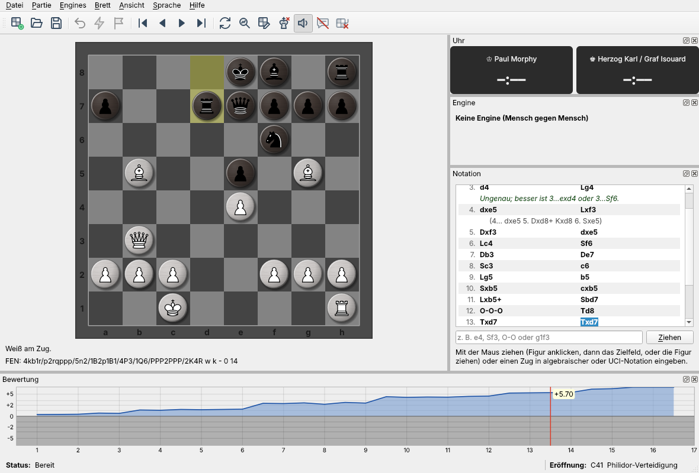
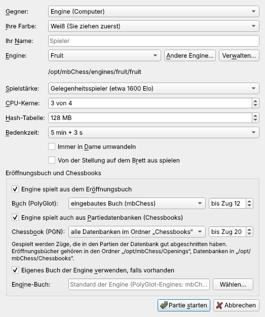
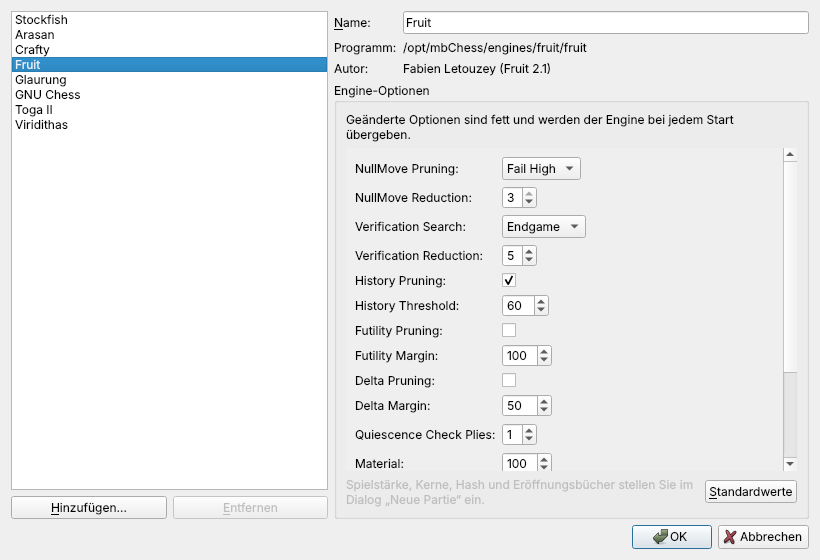
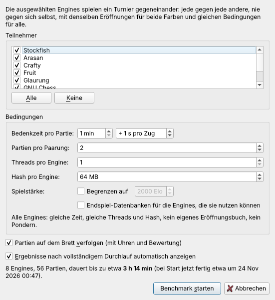
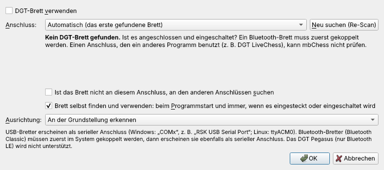

# Willkommen bei mbChess

mbChess ist ein freies Schachprogramm für Windows, Linux und macOS (Android folgt). Sie
können damit gegen starke Schach-Engines spielen, Partien nachspielen und analysieren,
Stellungen aufbauen, Matts suchen lassen, Engines gegeneinander antreten lassen und mit
einem elektronischen DGT-Brett spielen.

Das Wichtigste in Kürze:

- **Spielen** gegen eine Engine, gegen einen Menschen am selben Brett oder Engine gegen Engine
  zuschauen, mit Schachuhr, einstellbarer Spielstärke, Eröffnungsbuch und Chessbooks.
- **Mitgelieferte Engines**: Stockfish, Arasan, Fruit, Toga II, Glaurung, GNU Chess und
  Viridithas. Weitere UCI-Engines lassen sich hinzufügen.
- **Analyse** mit einer Engine, Bewertungsgraph, Varianten und Kommentaren.
- **Partiedatenbanken** im PGN-Format, auch mit zehntausenden Partien.
- **Brett-Editor** und **Mattsuche**.
- **Engine-Benchmark**: ein Rundenturnier der Engines unter gleichen Bedingungen.
- **Endspiel-Datenbanken** (Syzygy) zum Herunterladen.
- **DGT-Bretter** über USB oder Bluetooth.
- Hunderte **Bretter und Figurensätze**, Zuggeräusche und **Zugansagen** auf Deutsch oder Englisch.

mbChess ist freie Software unter der GNU General Public License, Version 3 oder später.
Es wird ohne jede Gewährleistung geliefert.

# Installation und Programmstart

## Windows

Starten Sie den Installer `mbChess-<Version>-de-setup.exe` (Deutsch) oder
`mbChess-<Version>-en-setup.exe` (Englisch). Der Assistent schlägt den Ordner `C:\mbChess`
vor und bietet diese Komponenten an:

| Komponente | Inhalt | Vorgabe |
| --- | --- | --- |
| mbChess | das Programm mit Hilfe (CHM), Brettern, Figuren und Klängen | immer |
| UCI-Schach-Engines | die mitgelieferten Engines, jede einzeln abwählbar | an |
| Sprachaufnahme | Programm zum Aufnehmen eigener Zugansagen | aus |
| Handbuch (PDF) | dieses Handbuch als PDF-Datei | aus |

Eine vorhandene Installation wird dabei ersetzt. Deinstallieren können Sie mbChess über
„Einstellungen → Apps“ oder über „mbChess deinstallieren“ im Startmenü. Dort finden Sie auch die „mbChess-Hilfe“.

## Linux und macOS

Unter Linux und macOS wird mbChess zurzeit aus dem Quelltext gebaut (Qt 6.4 oder neuer,
unter macOS Catalina Qt 5.15). Die Anleitung steht in der Datei `README.md` des Quelltexts.
Das Ergebnis liegt im Ordner `bin` des Build-Ordners.

## Der Startbildschirm

Beim Start zeigt mbChess einen Startbildschirm mit Versionsnummer, dem gerade geladenen
Teil (Einstellungen, Bretter und Figuren, Engines und Bücher, Suche nach einem DGT-Brett)
und einem Fortschrittsbalken. Sie schalten ihn mit **Ansicht → Startbildschirm anzeigen**
ab und wieder ein.

## Kommandozeile

| Aufruf | Wirkung |
| --- | --- |
| `mbchess partie.pgn` | öffnet die PGN-Datei |
| `mbchess --fen "<FEN>"` | stellt die Stellung aus der FEN auf das Brett |

# Das Hauptfenster

Das Hauptfenster besteht aus dem Brett in der Mitte und mehreren Fenstern rundherum. Jedes
dieser Fenster lässt sich verschieben, an einen anderen Rand andocken, frei schweben lassen
oder schließen. Im Menü **Ansicht** schalten Sie sie wieder ein; **Ansicht →
Fensteranordnung zurücksetzen** stellt die ursprüngliche Anordnung her. Größe, Position und
Anordnung speichert mbChess selbst.

| Fenster | Inhalt |
| --- | --- |
| **Brett** | die Stellung; darunter der Zustand der Partie und die FEN der Stellung |
| **Uhr** | Namen der Spieler und die Bedenkzeit; die Seite am Zug ist hervorgehoben |
| **Engine** | was die Engine gerade rechnet: Tiefe, Bewertung, Hauptvariante, Geschwindigkeit |
| **Notation** | die Züge der Partie mit Varianten und Kommentaren, darunter die Zugeingabe |
| **Bewertung** | der Bewertungsgraph der Partie |
| **Partien** | die Partienliste einer geöffneten Datenbank |

## Die Statusleiste

Die Statusleiste am unteren Rand ist in Abschnitte geteilt:

- **Status:** allgemeine Meldungen, etwa „Partie gespeichert“ oder „Buchzug“. Ohne Meldung
  steht hier „Bereit“.
- **Chessbook:** der Fortschritt beim Einlesen eines Chessbooks (nur während des Lesens).
- **Eröffnung:** der ECO-Code und der Name der Eröffnung, bei deutscher Oberfläche mit
  deutschem Namen. Der Tooltip zeigt den internationalen Namen.
- **Benchmark:** Fortschritt eines laufenden Engine-Benchmarks mit Knopf zum Abbrechen.
- **DGT:** der Zustand des DGT-Bretts, etwa „✓ stimmt mit der Partie überein“ oder „bitte Sf6
  auf dem Brett ziehen“.

Ist ein Text zu lang, wird er mit „…“ gekürzt; der Tooltip zeigt ihn vollständig.

## Die Werkzeugleiste

Die Werkzeugleiste enthält von links nach rechts: Neue Partie, Partie öffnen, Partie
speichern, Zug zurücknehmen, Sofort ziehen, Aufgeben, zum Anfang, einen Zug zurück, einen Zug
vor, zum Ende, Brett drehen, Engine-Analyse, Stellung aufbauen, Matt suchen, Zuggeräusche,
Zugansage und DGT-Brett. Die Symbole für Zuggeräusche, Zugansage und DGT-Brett zeigen, ob die
Funktion an oder aus ist.

# Eine Partie spielen

## Neue Partie

**Datei → Neue Partie** (Strg+N) öffnet den Dialog für eine neue Partie.

| Einstellung | Bedeutung |
| --- | --- |
| **Gegner** | Engine (Computer), Mensch (beide Seiten an diesem Brett) oder Engine gegen Engine |
| **Ihre Farbe** | Weiß, Schwarz oder Zufall |
| **Ihr Name** | erscheint an der Uhr und in der gespeicherten PGN |
| **Engine** | der Gegner. „Andere Engine…“ wählt eine Programmdatei, „Verwalten…“ öffnet die Engine-Verwaltung |
| **Spielstärke** | von „Anfänger (etwa 1350 Elo)“ bis „Volle Spielstärke“ |
| **CPU-Kerne**, **Hash-Tabelle** | Rechenleistung und Speicher der Engine |
| **Bedenkzeit** | „Ohne Uhr“ oder eine Bedenkzeit mit Inkrement, zum Beispiel 5 min + 3 s |
| **Immer in Dame umwandeln** | ein Bauer auf der letzten Reihe wird ohne Rückfrage zur Dame |
| **Von der Stellung auf dem Brett aus spielen** | die Partie beginnt mit der aufgebauten Stellung statt mit der Grundstellung |
| **Eröffnungsbuch und Chessbooks** | siehe Kapitel „Eröffnungsbücher und Chessbooks“ |

Bei „Engine gegen Engine“ wählen Sie eine Engine für Weiß und eine für Schwarz; Sie schauen
dann zu.

## Züge eingeben

Sie haben mehrere Möglichkeiten:

- **Klicken**: die Figur anklicken, dann das Zielfeld.
- **Ziehen**: die Figur mit gedrückter Maustaste auf das Zielfeld ziehen.
- **Tippen**: den Zug in das Feld unter der Notation schreiben und Enter drücken, in
  algebraischer Notation (`e4`, `Sf3`, `O-O`, `exd5`, `e8=D`) oder in UCI-Notation (`g1f3`).
  Die englischen Figurenbuchstaben (N, B, R, Q) gehen ebenfalls.
- **DGT-Brett**: den Zug auf dem elektronischen Brett ausführen (Kapitel „DGT-Brett“).

Bei einer Umwandlung fragt mbChess nach der Figur, außer „Immer in Dame umwandeln“ ist an.

## Während der Partie

| Befehl | Taste | Wirkung |
| --- | --- | --- |
| Partie → Zug zurücknehmen | Strg+Z | nimmt Ihren letzten Zug (und den Antwortzug der Engine) zurück |
| Partie → Sofort ziehen! | Leertaste | die Engine soll sofort ziehen |
| Partie → Aufgeben | – | gibt die Partie verloren |
| Brett → Brett drehen | Strg+R | dreht das Brett |

Sie können während der Partie mit den Pfeiltasten zurückblättern. Gezogen wird aber nur am
Ende der Partie; die Ende-Taste bringt Sie zurück.

Die Partie endet mit Matt, Patt, dreifacher Stellungswiederholung, der 50-Züge-Regel,
ungenügendem Material, Zeitüberschreitung oder Aufgabe. Danach wird das Brett zum
Analysebrett: Sie können Züge ausprobieren und die Engine-Analyse einschalten.

Befehle, die eine laufende Partie beenden würden (eine neue Stellung, der Brett-Editor, die
Mattsuche, ein Benchmark auf dem Brett, das Beenden des Programms), fragen vorher nach.

# Partien öffnen und speichern

## PGN-Dateien

**Datei → Partie öffnen (PGN)** (Strg+O) liest eine PGN-Datei mit Varianten, Kommentaren,
Symbolen ($1, $2 …) und Bewertungen (`[%eval]`). **Datei → Partie als PGN speichern** (Strg+S)
schreibt die Partie samt Varianten, Kommentaren und den Bewertungen der Engine.

Enthält die Partie Züge, Varianten oder Kommentare, die noch nicht gespeichert sind, fragt
mbChess nach, bevor sie verloren gehen (beim Beenden, bei einer neuen Partie, beim Öffnen einer
anderen Partie, einer neuen Stellung), und bietet **Partie speichern…** an.

## Partiedatenbanken

Enthält die Datei mehrere Partien, erscheint das Fenster **Partien** mit einer Liste: Nummer,
Weiß, Elo, Schwarz, Elo, Ergebnis, Züge, ECO, Datum, Turnier, Ort und Runde. Ein Klick auf eine
Spaltenüberschrift sortiert, das Suchfeld filtert nach Spieler, Turnier, Ort, ECO oder Jahr.
Doppelklick oder Enter lädt eine Partie. **Datei → Vorherige Partie** (Strg+Bild↑) und
**Nächste Partie** (Strg+Bild↓) blättern durch die (gefilterte) Liste.

Große Dateien (60.000 Partien und mehr) liest mbChess im Hintergrund ein; Sie können
währenddessen weiterarbeiten.

## FEN

**Datei → Stellung aus FEN setzen** stellt eine Stellung aus einer FEN-Zeile auf das Brett,
**Datei → FEN kopieren** legt die FEN der aktuellen Stellung in die Zwischenablage. Die FEN
steht außerdem immer unter dem Brett.

# Notation, Varianten und Kommentare

Die Notation zeigt einen Zug pro Zeile (Nummer, Weiß, Schwarz). Kommentare stehen kursiv in
eigenen Zeilen, Varianten eingerückt in Klammern.

| Aktion | Wirkung |
| --- | --- |
| Klick auf einen Zug | springt zu dieser Stellung |
| ← / → | einen Zug zurück / vor |
| Pos1 / Ende | zum Anfang / zum Ende |
| Klick in den Bewertungsgraphen | springt zu diesem Zug |

Außerhalb einer laufenden Partie wird ein Zug mitten in der Partie zu einer neuen Variante.
Das Kontextmenü (rechte Maustaste) eines Zuges bietet:

- **Variante hochstufen**: die Variante wird zur Hauptvariante.
- **Ab hier löschen**: entfernt den Zug und alles danach.
- **Kommentar bearbeiten…**: Kommentar nach dem Zug schreiben oder ändern.

# Analyse

## Engine-Analyse

**Engines → Engine-Analyse** (Alt+F2) lässt eine Engine ohne Zeitlimit an der Stellung auf dem
Brett rechnen. Das Engine-Fenster zeigt für jede Zeile die Bewertung, die Tiefe und die
Hauptvariante. Die Analyse folgt jedem Zug und jedem Blättern.

- **Engines → Analyse-Engine** wählt die Engine.
- **Engines → Analyse-Zeilen** stellt 1 bis 5 Zeilen ein (MultiPV). Manche Engines zeigen nur
  eine Zeile.

Die Bewertung der besten Zeile wird am Zug gespeichert; sie erscheint im Bewertungsgraphen und
in der gespeicherten PGN. Während einer laufenden Partie gegen Engine oder Uhr ist die Analyse
gesperrt.

## Bewertungen lesen

Bewertungen gelten aus der Sicht von Weiß und werden in Bauerneinheiten angegeben: +1.00
heißt, Weiß steht etwa einen Bauern besser; −0.50 heißt, Schwarz steht etwas besser. „#3“
bedeutet Matt in drei Zügen für Weiß, „#−3“ für Schwarz.

# Stellung aufbauen

**Partie → Stellung aufbauen** (Strg+E) öffnet den Brett-Editor mit einem leeren Brett.

- **Figuren setzen**: eine Figur aus der Leiste oben (Schwarz) oder unten (Weiß) aufs Brett
  ziehen, oder die Figur anklicken und dann beliebig viele Felder anklicken.
- **Verschieben**: Figuren auf dem Brett ziehen; mit gedrückter Strg-Taste wird kopiert.
- **Entfernen**: die Figur vom Brett ziehen oder mit der rechten Maustaste anklicken.
- **Brett leeren** und **Grundstellung** setzen das Brett zurück, **Aktuelle Stellung** holt die
  Stellung der laufenden Partie in den Editor.

Rechts stellen Sie ein, wer am Zug ist (Weiß, Schwarz oder „Vom Programm bestimmt“: die Seite im
Schach, sonst Weiß), die erlaubten Rochaden, das En-passant-Feld und die Zugnummer. In der
FEN-Zeile unten können Sie auch eine FEN eintippen oder einfügen und mit Enter übernehmen.
**Stellung laden…** und **Stellung speichern…** lesen und schreiben `.fen`-Dateien.

mbChess prüft die Stellung laufend (Könige, Bauern auf der Grundreihe, Schach der Seite, die
nicht am Zug ist) und zeigt das Ergebnis unter der FEN. **Übernehmen** stellt die Stellung als
Analysebrett ins Hauptfenster; „Neue Partie“ bietet dann **Von der Stellung auf dem Brett aus
spielen** an.

# Mattsuche

**Engines → Matt suchen** (Strg+M) sucht in der Stellung auf dem Brett ein Matt.

| Einstellung | Bedeutung |
| --- | --- |
| **Engine** | Vorgabe ist Stockfish, der eine eigene Mattsuche hat |
| **Matt in höchstens** | die Zahl der Züge |
| **Zeitlimit** | wie lange höchstens gesucht wird |
| **Auch Nebenlösungen suchen (Duale)** | prüft, ob auch andere Züge matt setzen (langsamer, nur Engines mit MultiPV) |

**Suche starten** beginnt die Suche. mbChess zeigt die Lösung in Kurzschreibweise, ob es ein
kürzeres Matt gibt und ob Nebenlösungen existieren. **Als Variante übernehmen** fügt die
Lösung in die Partie ein; mit der Pfeiltaste nach rechts gehen Sie sie durch.

# Engines

## Mitgelieferte Engines

| Engine | Stärke | Besonderheit |
| --- | --- | --- |
| Stockfish | eine der stärksten Engines | neuronales Netz, Mattsuche, Syzygy |
| Arasan | sehr stark | Syzygy, eigenes Buch |
| Viridithas | sehr stark | neuronales Netz, Syzygy |
| Toga II, Fruit | mittel bis stark | klassisch, PolyGlot-Buch |
| Glaurung | mittel bis stark | klassisch |
| GNU Chess | mittel | eigenes Buch |

Crafty wird nicht mitgeliefert, weil seine Lizenz die Weitergabe verbietet. Wer es selbst baut,
legt es in den Ordner `engines` neben dem Programm.

## Engines verwalten

**Engines → Engines verwalten** zeigt alle Engines. Engines im Ordner `engines` neben dem
Programm stehen immer in der Liste.

- **Hinzufügen…** nimmt eine weitere UCI-Engine auf (die Programmdatei auswählen).
- **Entfernen** nimmt sie wieder aus der Liste; die Datei bleibt, wo sie ist.
- **Name** ändert den angezeigten Namen.
- **Engine-Optionen** zeigt alle Optionen, die die Engine meldet. Geänderte Optionen sind fett
  und werden der Engine bei jedem Start übergeben. **Standardwerte** setzt sie zurück.

Spielstärke, Kerne, Hash und Eröffnungsbücher stellen Sie im Dialog „Neue Partie“ ein.

# Eröffnungsbücher und Chessbooks

Im Dialog „Neue Partie“ legen Sie fest, woher die Engine ihre Eröffnungszüge nimmt.

- **Engine spielt aus dem Eröffnungsbuch**: ein Buch im PolyGlot-Format (`.bin`), bis zu einer
  einstellbaren Zugnummer. Eingebaut ist ein eigenes Buch aus den benannten Eröffnungen.
  Weitere Bücher legen Sie in den Ordner `Openings` neben dem Programm.
- **Engine spielt auch aus Partiedatenbanken (Chessbooks)**: mbChess liest eine PGN-Datenbank
  (oder alle im Ordner `Chessbooks`) und spielt Züge, die in diesen Partien gut abgeschnitten
  haben, ähnlich wie Crafty mit seinen Büchern.
- **Eigenes Buch der Engine verwenden**: Fruit, Toga, GNU Chess und Arasan haben eigene Bücher.

Spielt die Engine einen Buchzug, steht „Buchzug: …“ im Engine-Fenster.

# Endspiel-Datenbanken

Syzygy-Endspiel-Datenbanken enthalten das perfekte Ergebnis jeder Stellung mit wenigen
Steinen. Engines, die sie lesen können (Stockfish, Arasan, Viridithas, Crafty), spielen solche
Endspiele damit fehlerfrei.

**Engines → Endspiel-Datenbanken (Syzygy)** zeigt, wie viele Tabellen vorhanden sind, und
lädt die Tabellen mit 3, 4 und 5 Steinen herunter: nur die Ergebnisse (WDL, etwa 378 MB) oder
dazu den Abstand zum nächsten Bauernzug oder Schlag (WDL + DTZ, etwa 939 MB, empfohlen). Ein
abgebrochener Download lässt sich später fortsetzen. Der Ordner ist `Syzygy` neben dem
Programm und lässt sich ändern.

# Engine-Benchmark

**Datei → Benchmarks → Engine-Turnier** lässt die ausgewählten Engines ein Rundenturnier
gegeneinander spielen: jede gegen jede, mit denselben Eröffnungen für beide Farben und gleichen
Bedingungen.

| Einstellung | Bedeutung |
| --- | --- |
| **Teilnehmer** | die Engines (mindestens zwei) |
| **Bedenkzeit pro Partie** | zum Beispiel 5 min + 3 s pro Zug |
| **Partien pro Paarung** | bei einer geraden Zahl wird jede Eröffnung mit beiden Farben gespielt |
| **Threads**, **Hash** | gleich für alle; ein Thread ist der fairste Vergleich |
| **Spielstärke begrenzen** | alle Engines auf dieselbe Elo-Zahl |
| **Endspiel-Datenbanken** | standardmäßig aus, weil sie nur einigen Engines helfen |
| **Partien auf dem Brett verfolgen** | das Brett zeigt die laufende Partie mit Uhren und Bewertung |

Vor dem Start nennt mbChess die erwartete Dauer. Der Fortschritt steht in der Statusleiste;
über den Knopf daneben oder **Datei → Benchmarks → Benchmark abbrechen** brechen Sie ab.
Läuft eine Partie und wollen Sie den Benchmark auf dem Brett verfolgen, fragt mbChess vorher,
denn die Partie wird dann beendet.

Solange der Benchmark läuft, gehören Brett und Engines ihm: Neue Partie, Partien öffnen,
Stellung aufbauen, FEN einfügen, Mattsuche, Stellung vom DGT-Brett übernehmen und Engines
verwalten sind ausgegraut, bis er beendet oder abgebrochen ist.

**Datei → Benchmarks → Ergebnisse anzeigen** zeigt die Tabelle (der Sieger ist hervorgehoben)
und alle Partien mit Dauer; die Partien lassen sich als PGN speichern.

# DGT-Brett

mbChess spielt mit elektronischen Brettern von DGT, die über USB oder Bluetooth Classic
angeschlossen sind. Die Bretter erscheinen im System als serieller Anschluss (Windows „COMx“,
Linux `ttyACM0` oder `rfcomm0`). Bluetooth-Bretter müssen vorher im System gekoppelt werden.
Das DGT Pegasus (nur Bluetooth LE) wird nicht unterstützt.

## Einrichten

**Brett → DGT-Brett einstellen…** sucht beim Öffnen sofort nach einem Brett und zeigt, an
welchem Anschluss es antwortet, mit Name, Version und der Stellung auf dem Brett.

- **Anschluss**: „Automatisch (das erste gefundene Brett)“ oder ein bestimmter Anschluss.
  **Neu suchen (Re-Scan)** sucht erneut.
- **An den anderen Anschlüssen suchen**: ist das Brett nicht am gewählten Anschluss, werden die
  übrigen geprüft.
- **Brett selbst finden und verwenden**: beim Programmstart und immer, wenn das Brett
  eingesteckt oder eingeschaltet wird.
- **Ausrichtung**: „An der Grundstellung erkennen“ (Grundstellung aufstellen, mbChess erkennt,
  wie herum das Brett liegt) oder fest eingestellt.

## Spielen

**Brett → DGT-Brett verwenden** (Strg+D, Werkzeugleiste) schaltet das Brett ein und aus.
Führen Sie Ihre Züge auf dem Brett aus: Sobald das Brett kurz ruhig ist und genau ein gültiger
Zug passt, wird er gespielt. Den Zug der Engine zeigt die Statusleiste („DGT: bitte Sf6 auf dem
Brett ziehen“); führen Sie ihn auf dem Brett aus. „✓ stimmt mit der Partie überein“ bestätigt,
dass Brett und Partie gleich sind; sonst steht dort, auf wie vielen Feldern sie sich
unterscheiden.

**Brett → Stellung vom DGT-Brett übernehmen…** öffnet den Brett-Editor mit den Figuren, die auf
dem Brett stehen.

Wird das Brett aus- oder abgesteckt, meldet mbChess das und verbindet sich wieder, sobald es
antwortet.

Während eines Engine-Benchmarks und einer Partie Engine gegen Engine pausiert das Brett: Züge
darauf werden ignoriert, die Statusleiste zeigt „DGT: pausiert …“. Danach arbeitet es von
selbst wieder.

# Bretter, Figuren, Klänge und Sprache

## Brett und Figuren

Im Menü **Brett** wählen Sie unter **Brettoptik** und **Figuren** aus vielen Themen: das graue
mbChess-Brett mit Figuren auf Holzscheiben, das Holzbrett „mbChess (klassisch)“, die Bretter
und Figuren von AmiChess und über 170 Bretter und rund 50 Figurensätze aus Lucas Chess.
**Koordinaten anzeigen** blendet die Buchstaben und Zahlen am Rand ein. Eigene Themen legen
Sie in den Ordner `themes` neben dem Programm.

## Klänge und Zugansagen

**Brett → Zuggeräusche** und **Brett → Züge ansagen** schalten Geräusche und Ansagen ein und
aus, ebenso die beiden Symbole in der Werkzeugleiste. Unter **Brett → Stimme** wählen Sie die
Stimme: automatisch nach Programmsprache, Deutsch (Thorsten), Englisch (LibriTTS), Englisch
(AmiChess-Original) oder eine selbst aufgenommene Stimme. Eigene Stimmen nehmen Sie mit dem
Programm **mbChess-Sprachaufnahme** Wort für Wort auf.

## Fenster-Design und Sprache

**Ansicht → Fenster-Design** wählt zwischen „System“ und „Dunkles Design“. Das Menü
**Sprache** schaltet zwischen Deutsch und Englisch um, auch die Figurenbuchstaben in der
Notation (K D T L S oder K Q R B N).

# Tastenkürzel

| Taste | Befehl |
| --- | --- |
| Strg+N | Neue Partie |
| Strg+O | Partie öffnen (PGN) |
| Strg+S | Partie als PGN speichern |
| Strg+Q | Beenden |
| Strg+Bild↑ / Strg+Bild↓ | Vorherige / nächste Partie der Datenbank |
| Strg+Z | Zug zurücknehmen |
| Leertaste | Sofort ziehen! |
| Strg+E | Stellung aufbauen |
| Strg+M | Matt suchen |
| Alt+F2 | Engine-Analyse an/aus |
| Strg+R | Brett drehen |
| Strg+D | DGT-Brett verwenden an/aus |
| Pos1 / ← / → / Ende | zum Anfang / zurück / vor / zum Ende |
| F1 | dieses Handbuch |

# Dateien und Ordner

Neben dem Programm (unter Windows meist `C:\mbChess`) liegen diese Ordner:

| Ordner | Inhalt |
| --- | --- |
| `engines` | die Engines, je eine pro Unterordner; neue Engines hier ablegen |
| `Openings` | Eröffnungsbücher im PolyGlot-Format (`*.bin`) |
| `Chessbooks` | Partiedatenbanken (`*.pgn`) für die Chessbooks |
| `Syzygy` | Endspiel-Datenbanken |
| `themes` | eigene Bretter und Figurensätze |
| `Handbuch` / `Manual` | dieses Handbuch (CHM unter Windows, PDF) |

Die Einstellungen speichert mbChess unter Windows in der Registry
(`HKEY_CURRENT_USER\Software\mbChess`), unter Linux in `~/.config/mbChess/mbChess.conf`
und unter macOS in `~/Library/Preferences/com.mbchess.mbChess.plist`.

# Hilfe bei Problemen

**Die Engine startet nicht.** Prüfen Sie in **Engines → Engines verwalten**, ob die Engine
antwortet. Eine Engine muss das UCI-Protokoll sprechen; reine XBoard-Engines werden nicht
unterstützt.

**Ich kann nicht ziehen.** Während einer Partie wird nur am Ende gezogen (Ende-Taste). Ist die
Engine am Zug, warten Sie oder drücken die Leertaste. Beim Verfolgen eines Benchmarks sind
eigene Züge gesperrt.

**Das DGT-Brett wird nicht gefunden.** Ist es angeschlossen und eingeschaltet? Ein
Bluetooth-Brett muss gekoppelt sein. Ein Anschluss, den ein anderes Programm (etwa DGT
LiveChess) benutzt, kann mbChess nicht prüfen; schließen Sie das andere Programm.

**Es gibt keine Klänge.** Prüfen Sie **Brett → Zuggeräusche**. Ohne Qt Multimedia gebaute
Versionen sind stumm.

**Das Fenster ist durcheinander.** **Ansicht → Fensteranordnung zurücksetzen**.

# Lizenz und Dank

mbChess © Michael Bergmann 2026, freie Software unter der GNU General Public License,
Version 3 oder später. Den Lizenztext enthält die Datei `LICENSE.txt` im Programmordner.

mbChess verwendet Qt (The Qt Company, LGPL) sowie Material vieler freier Projekte: die Figuren
„cburnett“ von Colin M.L. Burnett, Bretter und Figuren aus AmiChess und Lucas Chess, die Stimme
„Thorsten“ von Thorsten Müller, die Stimme „LibriTTS“, die Eröffnungsnamen von lichess.org und
die Engines Stockfish, Arasan, Fruit, Toga II, Glaurung, GNU Chess und Viridithas mit ihren
Autoren. Die vollständige Liste steht in der Datei `CREDITS.md` des Quelltexts.

Vielen Dank an DGT für die Beschreibung des Brett-Protokolls.
