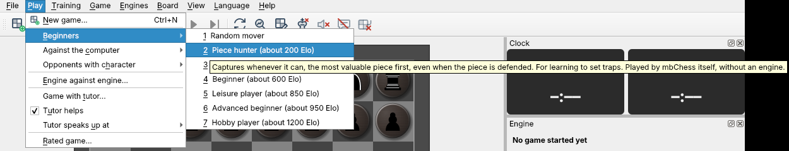
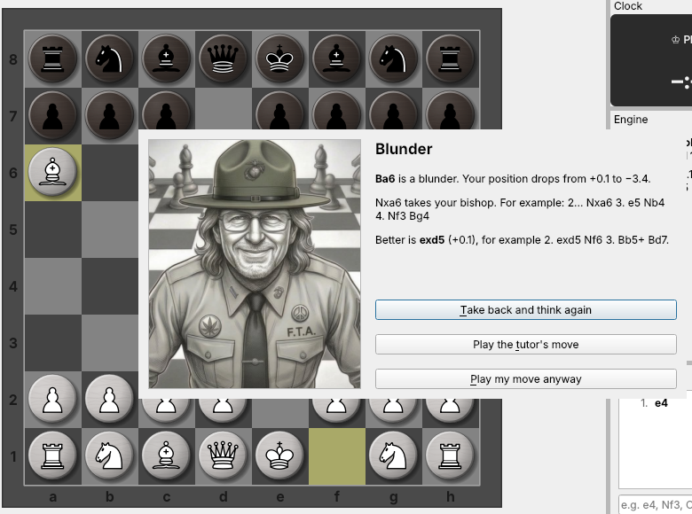
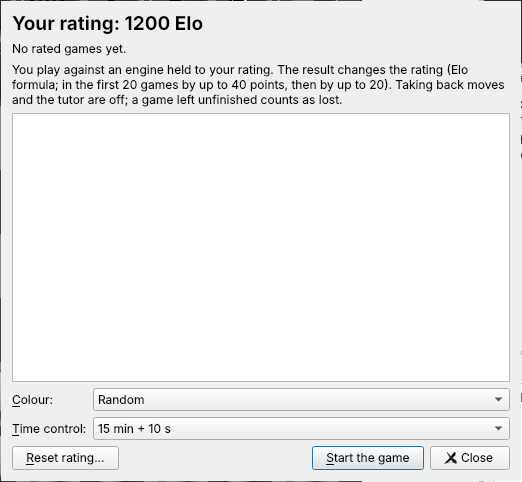
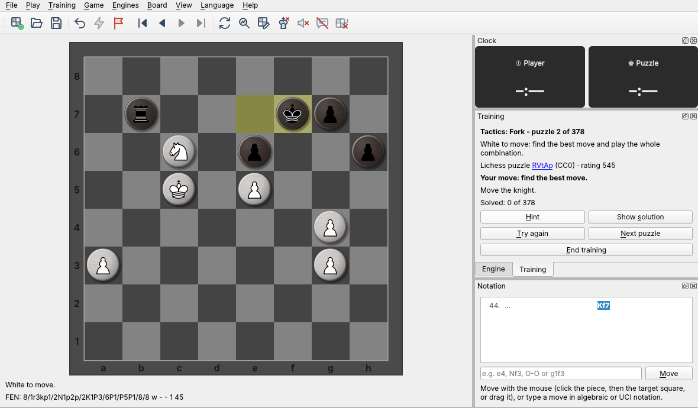
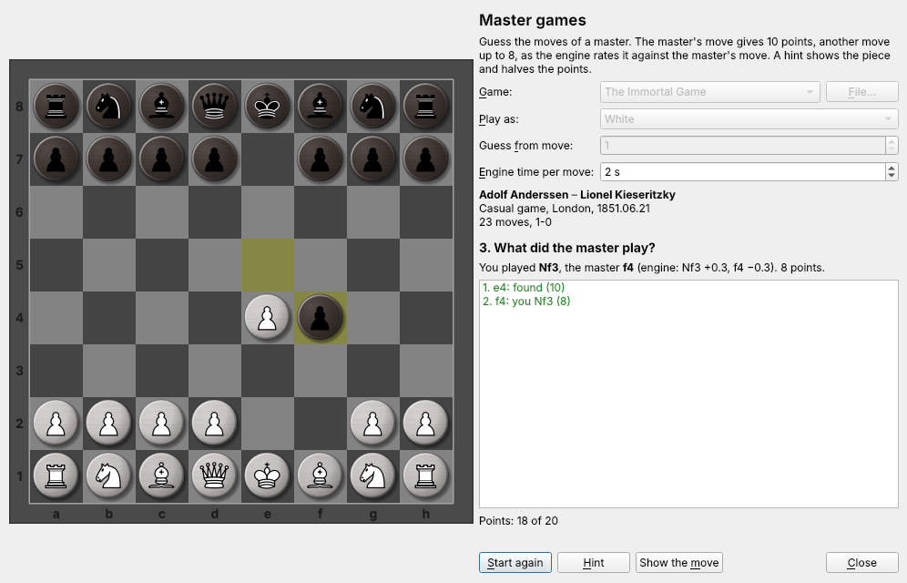
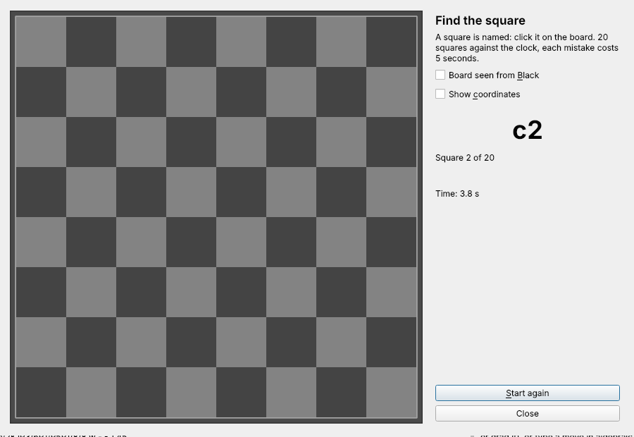
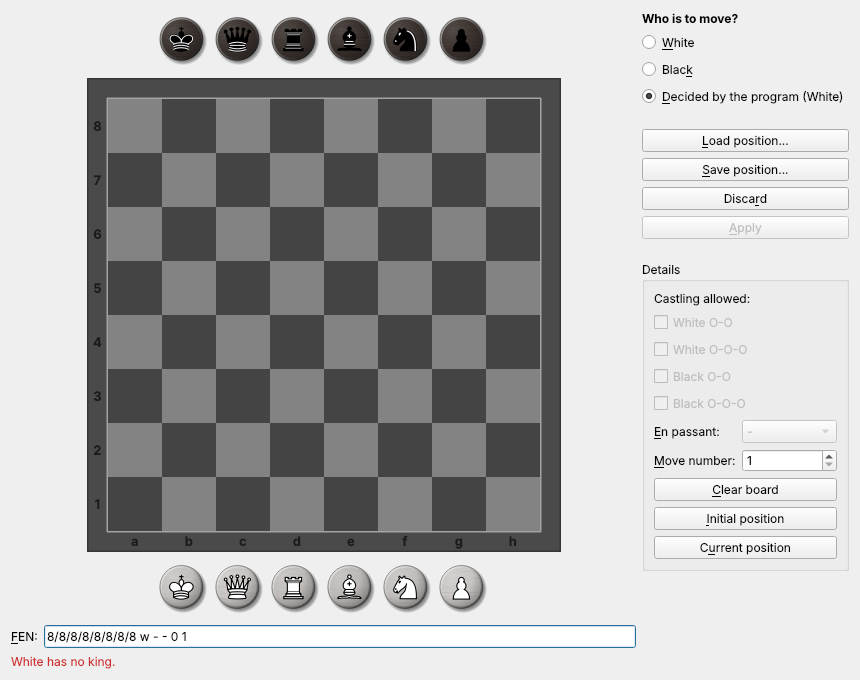
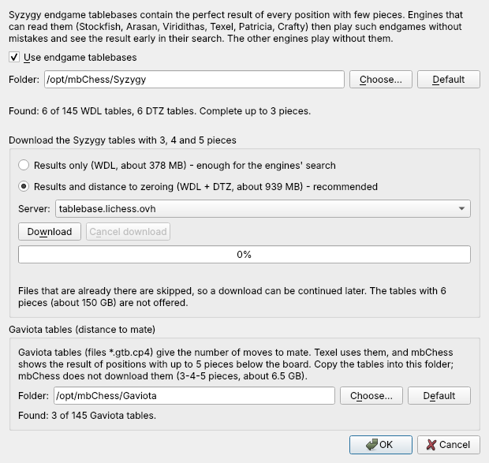

# Welcome to mbChess

mbChess is a free chess program for Windows, Linux and macOS (Android will follow). You can
play against strong chess engines and against opponents of any strength, practise with a tutor
at your side, solve mate, tactics and endgame puzzles, train openings and board vision, replay
and analyse games, let engines play each other and play on an electronic DGT board.

At a glance:

- **Play** against an engine, against a human on the same board, or watch engine against
  engine, with a chess clock, adjustable strength, opening book and chessbooks.
- **Ready-made opponents** in the Play menu: from the "Random mover" for your first steps
  through club players and masters to opponents with a character of their own.
- **Game with tutor**: a tutor looks at each of your moves and speaks up before a bad one is
  played.
- **Rated games** with an Elo rating of your own that grows with you.
- **Training**: mate in 1 to 3, more than 2,300 tactics puzzles in 22 themes, opening
  repertoire, guessing the moves of master games, holding out against the strongest engine,
  endgames and exercises for board vision and memory.
- **Engines included**: Stockfish, Arasan, Fruit, Toga II, Glaurung, GNU Chess, Viridithas,
  Texel, Patricia and the Tarrasch Toy Engine. More UCI engines can be added.
- **Analysis** with an engine, evaluation graph, variations and comments.
- **Game databases** in PGN format, even with tens of thousands of games.
- **Board editor** and **mate search**.
- **Engine benchmark**: a round-robin tournament of the engines under equal conditions.
- **Endgame tablebases**: Syzygy to download, Gaviota with the distance to mate in the analysis.
- **DGT boards** via USB or Bluetooth.
- Hundreds of **boards and piece sets**, move sounds and **move announcements** in English or
  German.

mbChess is free software under the GNU General Public License, version 3 or later. It comes
without any warranty.

# Installation and start

## Windows

Run the installer `mbChess-<version>-en-setup.exe` (English) or
`mbChess-<version>-de-setup.exe` (German). The wizard suggests the folder `C:\mbChess` and
offers these components:

| Component | Contents | Default |
| --- | --- | --- |
| mbChess | the program with help (CHM), boards, pieces, sounds and training puzzles | always |
| UCI chess engines | the included engines, each one can be deselected | on |
| Voice recorder | program to record your own move announcements | off |
| Manual (PDF) | this manual as a PDF file | off |

An existing installation is replaced; your settings, rating and training progress are kept.
Uninstall mbChess with "Settings → Apps" or with "Uninstall mbChess" in the Start menu, where
you also find "mbChess help".

## Linux and macOS

For Linux the download page offers an archive (`.tar.gz`) with the ready-built program and the
engines; it needs the system's Qt 6 libraries (Debian 12 and newer, Ubuntu 24.04 and newer).
Unpack it anywhere and start `mbchess` in the folder `bin`.

Or build mbChess from the source code (Qt 6.4 or newer, Qt 5.15 on macOS Catalina). The
instructions are in the file `README.md` of the source code. The result is in the folder `bin`
of the build folder.

## Test versions for beta testers

While mbChess is still being developed, the builds handed out are test versions. At the first
start a notice says that this is a developer version and until when it runs: each version runs
for **six weeks** from its first start. In the last week mbChess reminds you at every start to
install the current version soon; after that it only shows where to get the new one and quits.

A new version runs for another full six weeks. Settings, games, ratings and engines are kept
when you change versions. **Help → About mbChess** shows until when your version runs.

## The start screen

At start mbChess shows a start screen with the version number, the part being loaded
(settings, boards and pieces, engines and books, looking for a DGT board) and a progress bar.
Switch it off and on with **View → Show the start screen**.

## Command line

| Call | Effect |
| --- | --- |
| `mbchess game.pgn` | opens the PGN file |
| `mbchess --fen "<FEN>"` | puts the position from the FEN on the board |

# The main window

The main window has the board in the middle and several windows around it. Each of these
windows can be moved, docked at another edge, left floating or closed. Switch them on again in
the **View** menu; **View → Reset window layout** restores the original layout. mbChess saves
size, position and layout by itself.

| Window | Contents |
| --- | --- |
| **Board** | the position; below it the state of the game and the FEN of the position |
| **Clock** | the players' names and their time; the side to move is highlighted |
| **Engine** | what the engine is calculating: depth, evaluation, main line, speed |
| **Training** | task, hints and buttons of a training task (as a tab next to "Engine") |
| **Notation** | the moves of the game with variations and comments, below it the move input |
| **Evaluation** | the evaluation graph of the game |
| **Games** | the game list of an open database |

## The menus

| Menu | Contents |
| --- | --- |
| **File** | open and save games, step through a database, FEN, benchmarks, quit |
| **Play** | New game, ready-made opponents, engine against engine, game with tutor, rated game |
| **Training** | Find the mate, Tactics, Openings, Master games, Hold out, Endgames, Board and memory, Mate search |
| **Game** | take back, move now, resign, step through the game, set up a position |
| **Engines** | engine analysis, analysis engine and lines, manage engines, endgame tablebases |
| **Board** | flip board, coordinates, board style, pieces, sounds, voice, DGT board |
| **View** | show and hide windows, window layout, window theme, start screen |
| **Language** | Deutsch or English |
| **Help** | this manual (F1), About mbChess, About Qt |

## The status bar

The status bar at the bottom is divided into sections:

- **Status:** general messages, for example "Game saved", "Book move" or "The tutor looks at
  your move ...". Without a message it shows "Ready".
- **Chessbook:** progress while a chessbook is read (only while reading).
- **Opening:** the ECO code and the name of the opening.
- **Benchmark:** progress of a running engine benchmark with a button to cancel it.
- **DGT:** the state of the DGT board, for example "✓ matches the game" or "please play Nf6 on
  the board".

Text that is too long is shortened with "…"; the tooltip shows it in full.

## The toolbar

From left to right the toolbar holds: New game, Open game, Save game, Take back move, Move
now, Resign, go to the start, move back, move forward, go to the end, Flip board, Engine
analysis, Set up position, Mate search, Move sounds, Announce moves and DGT board. The icons
for move sounds, announcements and the DGT board show whether the function is on or off.

# Playing a game

## New game

**Play → New game** (Ctrl+N) opens the dialog for a new game. The ready-made opponents in the
same menu are quicker (chapter "The Play menu").

| Setting | Meaning |
| --- | --- |
| **Opponent** | Engine (computer), Human (both sides on this board) or Engine against engine |
| **Your colour** | White, Black or Random |
| **Your name** | shown at the clock and in the saved PGN |
| **Engine** | the opponent. "Other engine…" picks a program file, "Manage…" opens the engine list |
| **Strength** | from "Beginner (about 1350 Elo)" to "Full strength" |
| **CPU cores**, **Hash table** | computing power and memory of the engine |
| **Engine thinks on your time (ponder)** | the engine already searches while you think, on the move it expects from you. If you play it, it answers faster and better. Only at full strength and with engines that can do it (Stockfish, Arasan, Texel, Fruit, Toga II, Glaurung, GNU Chess) |
| **Time control** | "No clock" or a time with increment, for example 5 min + 3 s |
| **Always promote to queen** | a pawn on the last rank becomes a queen without asking |
| **Play from the position on the board** | the game starts from the position set up instead of the initial position |
| **Opening book and chessbooks** | see the chapter "Opening books and chessbooks" |

With "Engine against engine" you choose one engine for White and one for Black, and watch.

## Making moves

You have several ways:

- **Click**: click the piece, then the target square.
- **Drag**: drag the piece onto the target square.
- **Type**: type the move into the field below the notation and press Enter, in algebraic
  notation (`e4`, `Nf3`, `O-O`, `exd5`, `e8=Q`) or in UCI notation (`g1f3`).
- **DGT board**: make the move on the electronic board (chapter "DGT board").

On a promotion mbChess asks for the piece, unless "Always promote to queen" is on.

## During the game

| Command | Key | Effect |
| --- | --- | --- |
| Game → Take back move | Ctrl+Z | takes back your last move (and the engine's reply) |
| Game → Move now! | Space | the engine has to move at once |
| Game → Resign | – | gives up the game |
| Board → Flip board | Ctrl+R | turns the board round |

During the game you can step back with the arrow keys. Moves are made only at the end of the
game, though; the End key takes you back there.

The game ends with checkmate, stalemate, threefold repetition, the fifty-move rule,
insufficient material, loss on time or resignation. Then the board becomes an analysis board:
you can try moves and switch on the engine analysis.

Commands that would end a running game (a new position, the board editor, the mate search, a
training task, a benchmark on the board, quitting the program) ask first.

# The Play menu

Besides "New game" the **Play** menu offers ready-made opponents: one click and the game
starts. Colour, time control, your name, cores, hash and books are taken from the last settings
of "New game". The tooltip of each opponent describes its style and names the engine that plays
it. If that engine is missing, mbChess takes a suitable other one; if there is none at all, the
opponent is greyed out.

## Beginners

For everyone who is just learning chess or starting again. Beginner opponents play without a
clock and without an opening book, so you have all the time in the world.

| Opponent | Strength | Style |
| --- | --- | --- |
| Random mover | – | plays any legal move; for learning how the pieces move and capture |
| Piece hunter | about 200 Elo | captures whenever it can, the most valuable piece first, even when the piece is defended; for learning to set traps |
| Novice | about 400 Elo | often misses threats of a single move |
| Beginner | about 600 Elo | usually protects its pieces, but misses forks and skewers |
| Leisure player | about 850 Elo | likes to attack and makes human mistakes |
| Advanced beginner | about 950 Elo | plays actively, loses a piece now and then |
| Hobby player | about 1200 Elo | solid; mistakes only in longer variations |

The random mover and the piece hunter are played by mbChess itself, without an engine. The
others are Texel or Patricia at reduced strength. The Elo figures were measured in test
tournaments against Texel and are a guide.

## Against the computer

| Opponent | Strength |
| --- | --- |
| Casual player | about 1600 Elo: knows the basic rules of strategy, still overlooks tactics |
| Club player | about 1900 Elo: a solid club player |
| Expert | about 2200 Elo: a strong club player |
| Master | about 2500 Elo: plays like a master |
| Full strength | the engine at full strength: far stronger than any human |

These opponents are Stockfish (or else Arasan or Texel) at limited strength, with the time
control and books of "New game".

## Opponents with character

| Opponent | Strength | Style |
| --- | --- | --- |
| Attacker | about 1800 Elo | plays for the attack on the king and sacrifices material for it (Patricia) |
| Positional player | about 1800 Elo | plays calmly, improves its pieces and waits for your mistakes (Arasan) |
| Materialist | about 1800 Elo | grabs every pawn it can get and defends it (Texel) |
| Classic | about 2600 Elo | a classic engine of the 2000s without a neural network, at full strength: clear, principled chess (Fruit, Toga II or Glaurung) |

## Engine against engine

**Play → Engine against engine…** opens "New game" with the opponent "Engine against engine".
Choose the two engines and the time control and watch. For many games under equal conditions
there is the engine benchmark (chapter "Engine benchmark").

## Game with tutor

The tutor is a friendly but honest chess teacher. In games against the computer it looks at
each of your moves **before** it is played. If the move is bad, the tutor speaks up with a
picture, an explanation and a better suggestion.

- **Play → Game with tutor…** switches the tutor on and opens "New game".
- **Play → Tutor helps** switches it on and off for all games against the computer, the
  ready-made opponents included.
- **Play → Tutor speaks up at** sets how strict it is: at **Inaccuracies**, at **Mistakes**
  (default) or at **Blunders only**.

The tutor calculates with the analysis engine (**Engines → Analysis engine**). While it thinks,
your move is already shown on the board and the status bar says "The tutor looks at your move
...". It judges a move by how much your winning chances drop:

| Rating | Winning chance drops by |
| --- | --- |
| Inaccuracy | at least 5 percentage points |
| Mistake | at least 10 percentage points |
| Blunder | at least 15 percentage points |
| Terrible blunder | at least 35 percentage points |

Any mistake that costs 6 pawn units or more (the queen, for example) or allows the opponent a mate
also counts as a terrible blunder, even if the position was already lost or still clearly won.

The tutor's window names the move and its rating, what follows (for example "Then your opponent
mates you" or which piece is lost), how the evaluation drops, and a better move with an example
line. After a terrible blunder it shows a different picture and asks: "Are you stoned?!" You
have three choices:

- **Take back and think again**: your move is not played; you move again.
- **Play the tutor's move**: the tutor's suggestion is played.
- **Play my move anyway**: your move stands and the game goes on.

A move the tutor has nothing against is played without asking. In training tasks and rated
games the tutor is off.

## Rated game

In rated games you earn an **mbChess Elo rating** of your own. **Play → Rated game…** shows
your rating, your record (won, drawn, lost) and the last rated games. Choose colour and time
control and click **Start the game**.

- You start at **1200 Elo**. Your opponent is an engine (Texel preferred) set exactly to your
  current rating.
- After the game the rating changes by the Elo formula: by up to 40 points in the first 20
  games, then by up to 20.
- Below 1600 Elo the engine plays without an opening book.
- Taking back moves and the tutor are off.
- A game left unfinished (for example by a new game or by quitting the program) counts as
  lost.

**Reset rating…** starts again at 1200 Elo and forgets all rated games.

# The Training menu

The **Training** menu holds tasks that make you better step by step. Most of them run on the
main board, so a training task ends a running game (mbChess asks first). "Master games" and
"Board and memory" open a window of their own and leave the game on the main board alone.

During a task no engine helps: the engine analysis is switched off. mbChess does not accept
wrong moves at all; it says why the move does not fit, and you simply try again.

## The training window

Each task on the main board comes with the window **Training** (as a tab next to "Engine"). It
shows the title of the task (for example "Mate in 2 - puzzle 15 of 719"), the task itself, its
source (for example a Lichess puzzle with a link), messages about your moves in green (solved)
or red (failed) and your progress.

| Button | Effect |
| --- | --- |
| **Hint** | a hint, for example "Move the knight. The first move gives check." |
| **Show solution** | shows the solution (mate and tactics puzzles only) |
| **Try again** | starts the same task again |
| **Next puzzle** / **New position** / **New game** | the next task of the same kind |
| **End training** | ends the task; the board becomes an analysis board |

If you need a hint or make a mistake, you still solve the task, but it does not count as solved
and comes back later. mbChess remembers your progress (solved puzzles, best times, records);
the menus show it after each entry, for example "Fork (3 of 378 solved)". Each kind of training
has an entry **Reset progress…** (or "Reset results…", "Reset records…").

## Find the mate

**Training → Find the mate** offers **Mate in 1**, **Mate in 2** and **Mate in 3**, with about
700 puzzles each from the free puzzle database of lichess.org (CC0) and puzzles of mbChess's
own. They go from easy to hard.

In the Lichess puzzles your opponent makes a move first; watch it, then you find the mate. After
that the opponent always defends with the move that delays the mate longest. mbChess solves
every position exactly by itself: any move that mates in the moves left counts, even if it is
not the one in the solution. A move that does not mate in time is refused ("Nf7 does not mate
in time").

## Tactics

**Training → Tactics** holds more than 2,300 puzzles from lichess.org (CC0), sorted by theme:

| Group | Themes |
| --- | --- |
| Basic motifs | Hanging piece, Fork, Pin, Skewer, Discovered attack, Double check, Trapped piece |
| Combinations | Deflection, Attraction, Sacrifice, Capture the defender, Clearance, Interference, Intermediate move, X-ray attack |
| Special moves | Quiet move, Defensive move, Zugzwang, Promotion |
| Attack and endgame | Attack on the king, Pawn endgame, Rook endgame |

**Mixed** takes puzzles of all themes. As in "Find the mate" the opponent moves first. Then you
find the best move and play the whole combination; the opponent answers with the moves of the
solution. Only the move of the solution counts (or a move that mates at once). A puzzle you did
not solve comes back after three others. The hint names the piece and the puzzle's other
themes.

## Openings

**Training → Openings** trains openings move by move. The opponent picks a different
continuation each time, the more common ones more often.

- **Repertoire**: built in are "Italian Game for White" and "Caro-Kann for Black". You play
  the moves of your repertoire until the line ends. A move that is not in the repertoire is
  refused. The menu shows how many lines you have already played without a mistake.
- **Own repertoires (folder)…** opens the folder `Training/Repertoire` next to the program.
  Put PGN files with your repertoire there, variations welcome. The tag `[Repertoire "White"]`
  or `[Repertoire "Black"]` in the PGN says which side it is for; without it the menu offers
  both colours.
- **Opening book**: **Book moves as White** and **Book moves as Black** train the moves of the
  opening book chosen in "New game", up to the move number set there.

## Master games

**Training → Master games…** opens a window of its own where you guess the moves of a master.
Five famous games are built in: Anderssen – Kieseritzky ("The Immortal Game", 1851),
Anderssen – Dufresne ("The Evergreen Game", 1852), Morphy – Duke Karl and Count Isouard ("The
Opera Game", Paris 1858), Réti – Tartakower (Vienna 1910) and Ed. Lasker – Thomas (London
1912). **File…** loads any other PGN file.

Choose the game, your colour, from which move you guess, and how long the engine may check each
move, and click **Start**. Then:

- The master's move gives **10 points**.
- Another move gives up to 8 points, as the analysis engine rates it against the master's move.
- **Hint** shows the piece the master moves; the move then gives only half the points.
- **Show the move** shows the master's move, without points.

At the end you see your points, the percentage and how many master moves you found; mbChess
remembers your best result for each game.

## Hold out

In **Training → Hold out** you play against the strongest engine there is (Stockfish, or else
Arasan or Texel) at full strength. The aim is not to win but to hold out as long as possible:
the game ends as soon as the engine's evaluation for you falls below a limit.

- **Play as White** / **Play as Black** starts the game; your record is shown after it.
- **The game ends below** −1, −2 (default), −3 or −5 pawns.
- **Engine time per move**: 1, 2, 5 or 10 seconds.

The moves you held out are counted. Each colour and limit has a record of its own. Taking back
moves sets no record. There are no hints here.

## Endgames

**Training → Endgames** trains the most important basic endgames against an engine that defends
as well as it can (Texel preferred, 1 second per move). The positions are different every time.

| Endgame | Task | Move limit |
| --- | --- | --- |
| King and queen against king (KQK) | mate | 15 moves |
| King and rook against king (KRK) | mate | 25 moves |
| Two bishops (KBBK) | mate | 30 moves |
| Bishop and knight (KBNK) | mate | 40 moves |
| King and pawn: win | promote the pawn without throwing the win away | 20 moves |
| King against king and pawn: hold the draw | hold the draw or take the pawn | 20 moves |

mbChess knows the pawn endgames completely and checks each of your moves: a move that throws
the win away or loses ends the task with an explanation. For the mating endgames this needs the
Gaviota tablebases (chapter "Endgame tablebases"); without them mbChess checks only the number
of moves and the result. With tablebases the hint names the good moves; the training window
also gives a tip on the method (for example the bishops' wall in KBBK).

## Board and memory

**Training → Board and memory** opens a window of its own with exercises for board vision. At
the bottom of the window you choose whether the board is seen from Black and whether the
coordinates are shown.

| Exercise | Task |
| --- | --- |
| **Find the square** | a square is named: click it on the board |
| **Name the square** | a square is marked: type its name (for example e4) |
| **Light or dark?** | without looking at the board: is the named square light or dark? |
| **Remember the position** | look at a position, then set it up again from memory |
| **All checks and captures** | find every check and every capture of the side to move |
| **All moves** | find every legal move of the side to move |

The three square exercises run against the clock: 20 squares, each mistake costs 5 seconds.
mbChess remembers your best time.

In **Remember the position** you choose one of six levels (from a few pieces up to the full
position with 32 pieces) and the time to look. Then the position disappears and you set it up
again: choose a piece below or above the board and click the squares, or drag the pieces; a
right click removes a piece. **Check** shows pieces on wrong squares in red and missing ones
with a red frame; you can switch between your position and the original.

In the two move exercises you make the moves on the board; they are not played, only counted.
**Give up and show the rest** shows the missing moves in red.

## Mate search

**Training → Mate search…** (Ctrl+M) lets an engine look for a mate in any position, for
example a puzzle from a book. It is described in the chapter "Mate search".

## Puzzles of your own

Put more puzzles into the folder `Training` next to the program:

- `mate1*.txt`, `mate2*.txt`, `mate3*.txt` for mate in 1, 2 and 3 and `tactics*.txt` for
  tactics, one puzzle per line in the format `Name;FEN;opponent's move;solution;rating` (moves
  in UCI notation, several solution moves separated by spaces; "-" if the opponent does not
  move first; for tactics the themes as a sixth column, for example `fork pin`).
- Or a CSV file from the lichess.org puzzle database (`lichess_db_puzzle.csv` or a part of it);
  mbChess sorts the puzzles in by itself.

# Opening and saving games

## PGN files

**File → Open game (PGN)** (Ctrl+O) reads a PGN file with variations, comments, symbols ($1,
$2 …) and evaluations (`[%eval]`). **File → Save game as PGN** (Ctrl+S) writes the game with
its variations, comments and the engine's evaluations.

If the game holds moves, variations or comments that are not saved yet, mbChess asks before
they are lost (on quitting, a new game, opening another game, a new position) and offers
**Save game…**.

## Game databases

If the file holds several games, the window **Games** shows a list: number, White, Elo, Black,
Elo, result, moves, ECO, date, event, site and round. Click a column header to sort; the search
field filters by player, event, site, ECO or year. Double click or Enter loads a game.
**File → Previous game** (Ctrl+PgUp) and **Next game** (Ctrl+PgDown) step through the
(filtered) list.

mbChess reads large files (60,000 games and more) in the background; you can go on working
meanwhile.

## FEN

**File → Set position from FEN** puts a position from a FEN line on the board, **File → Copy
FEN** copies the FEN of the current position to the clipboard. The FEN is also always shown
below the board.

# Notation, variations and comments

The notation shows one move per line (number, White, Black). Comments are in italics on their
own lines, variations indented in brackets.

| Action | Effect |
| --- | --- |
| Click a move | goes to this position |
| ← / → | one move back / forward |
| Home / End | to the start / to the end |
| Click into the evaluation graph | goes to this move |

Outside a running game, a move in the middle of the game becomes a new variation. The context
menu (right mouse button) of a move offers:

- **Promote variation**: the variation becomes the main line.
- **Delete from here**: removes the move and everything after it.
- **Edit comment…**: write or change the comment after the move.

# Analysis

## Engine analysis

**Engines → Engine analysis** (Alt+F2) lets an engine search the position on the board without
a time limit. The engine window shows the evaluation, depth and main line of every line. The
analysis follows every move and every step through the game.

- **Engines → Analysis engine** chooses the engine.
- **Engines → Analysis lines** sets 1 to 5 lines (MultiPV). Some engines show only one line.

The evaluation of the best line is stored at the move; it appears in the evaluation graph and
in the saved PGN. During a running game against an engine or with a clock and during a
training task the analysis is locked.

## Reading evaluations

Evaluations are from White's point of view, in pawn units: +1.00 means White is about a pawn
better; −0.50 means Black is slightly better. "#3" means mate in three moves for White, "#−3"
for Black.

# Setting up a position

**Game → Set up position** (Ctrl+E) opens the board editor with an empty board.

- **Place pieces**: drag a piece from the bar at the top (Black) or bottom (White) onto the
  board, or click the piece and then click as many squares as you like.
- **Move**: drag pieces on the board; hold Ctrl to copy.
- **Remove**: drag the piece off the board or right-click it.
- **Clear board** and **Initial position** reset the board, **Current position** brings the
  position of the running game into the editor.

On the right you set who is to move (White, Black or "Decided by the program": the side in
check, otherwise White), the castling rights, the en passant square and the move number. In
the FEN line at the bottom you can also type or paste a FEN and apply it with Enter. **Load
position…** and **Save position…** read and write `.fen` files.

mbChess checks the position all the time (kings, pawns on the back ranks, check of the side not
to move) and shows the result below the FEN. **Apply** puts the position into the main window
as an analysis board; "New game" then offers **Play from the position on the board**.

# Mate search

**Training → Mate search…** (Ctrl+M, toolbar) looks for a mate in the position on the board.
Unlike the puzzles in "Find the mate" it works with any position, for example one you set up
with the board editor.

| Setting | Meaning |
| --- | --- |
| **Engine** | Stockfish by default, which has its own mate search |
| **Mate in at most** | the number of moves |
| **Time limit** | how long the search may take at most |
| **Look for other solutions too (duals)** | checks whether other moves mate as well (slower, only engines with MultiPV) |

**Start search** begins the search. mbChess shows the solution, whether there is a shorter
mate and whether other solutions exist. **Insert as variation** adds the solution to the game;
step through it with the right arrow key.

# Engines

## Included engines

| Engine | Strength | Notes |
| --- | --- | --- |
| Stockfish | one of the strongest engines | neural network, mate search, Syzygy |
| Arasan | very strong | Syzygy, own book |
| Viridithas | very strong | neural network, Syzygy |
| Texel | very strong | neural network, Syzygy and Gaviota, adjustable strength |
| Patricia | strong, very aggressive | neural network, Syzygy, adjustable strength |
| Toga II, Fruit | medium to strong | classic, PolyGlot book |
| Glaurung | medium to strong | classic |
| GNU Chess | medium | own book |
| Tarrasch Toy Engine | weak | small and simple, good for beginners |

Crafty is not included because its licence forbids redistribution. If you build it yourself,
put it into the folder `engines` next to the program.

## Managing engines

**Engines → Manage engines** shows all engines. Engines in the folder `engines` next to the
program are always in the list.

- **Add…** adds another UCI engine (choose the program file).
- **Remove** takes it off the list; the file stays where it is.
- **Name** changes the name shown.
- **Engine options** shows all options the engine reports. Changed options are shown in bold
  and are sent to the engine at every start. **Restore defaults** resets them.

Strength, cores, hash and opening books are set in the "New game" dialog.

# Opening books and chessbooks

In the "New game" dialog you decide where the engine takes its opening moves from.

- **Engine plays from the opening book**: a book in PolyGlot format (`.bin`), up to a move
  number you choose. A book made from the named openings is built in. Put more books into the
  folder `Openings` next to the program.
- **Engine also plays from game databases (chessbooks)**: mbChess reads a PGN database (or all
  of them in the folder `Chessbooks`) and plays moves that scored well in these games, much like
  Crafty does with its books.
- **Let the engine use its own book**: Fruit, Toga, GNU Chess and Arasan have their own books.

When the engine plays a book move, "Book move: …" is shown in the engine window.

# Endgame tablebases

Syzygy endgame tablebases hold the perfect result of every position with few pieces. Engines
that can read them (Stockfish, Arasan, Viridithas, Texel, Patricia, Crafty) play such endgames
without a flaw.

**Engines → Endgame tablebases** shows how many tables are there and downloads the
tables with 3, 4 and 5 pieces: results only (WDL, about 378 MB) or also the distance to the next
pawn move or capture (WDL + DTZ, about 939 MB, recommended). A cancelled download can be
continued later. The folder is `Syzygy` next to the program and can be changed.

**Gaviota tables** (files `*.gtb.cp4`) also hold the number of moves to mate. Put them into the
folder `Gaviota` next to the program or choose another folder in the same dialog; mbChess does
not download them itself (3–5 pieces, about 6.5 GB). Texel uses them when playing, and in the
analysis (no engine opponent, no clock) mbChess shows the result of positions with up to 5
pieces in the status line, for example "Tablebase: White mates in 9 moves." During a game this
hint is not shown.

# Engine benchmark

**File → Benchmarks → Engine tournament** lets the selected engines play a round-robin
tournament: every engine against every other one, with the same openings for both colours and
equal conditions.

| Setting | Meaning |
| --- | --- |
| **Participants** | the engines (at least two) |
| **Time per game** | for example 5 min + 3 s per move |
| **Games per pairing** | with an even number every opening is played with both colours |
| **Threads**, **Hash** | the same for all; one thread is the fairest comparison |
| **Limit playing strength** | all engines at the same Elo |
| **Endgame tablebases** | off by default, because they help only some engines |
| **Follow the games on the board** | the board shows the running game with clocks and evaluation |

Before the start mbChess shows the expected duration. The progress is in the status bar;
cancel with the button next to it or with **File → Benchmarks → Cancel benchmark**. If a game
is running and you want to follow the benchmark on the board, mbChess asks first, because the
game is ended then.

While the benchmark runs, the board and the engines belong to it: New game, opening games,
Set up position, Paste FEN, Mate search, taking the position from the DGT board and Manage
engines are greyed out until it is finished or cancelled.

**File → Benchmarks → Show results** shows the table (the winner is highlighted) and all games
with their duration; the games can be saved as PGN.

# DGT board

mbChess plays with electronic boards from DGT connected via USB or Bluetooth Classic. The
boards appear in the system as a serial port (Windows "COMx", Linux `ttyACM0` or `rfcomm0`).
Bluetooth boards have to be paired in the system first. The DGT Pegasus (Bluetooth LE only) is
not supported.

## Setting up

**Board → DGT board settings…** looks for a board at once when it opens and shows on which port
it answers, with name, version and the position on the board.

- **Port**: "Automatic (the first board found)" or a particular port. **Re-scan** looks again.
- **Look for it on the other ports**: if the board is not on the chosen port, the others are
  checked.
- **Find and use the board by itself**: at program start and whenever the board is plugged in
  or switched on.
- **Orientation**: "Detect from the initial position" (set up the initial position, mbChess
  sees which way round the board lies) or fixed.

## Playing

**Board → Use the DGT board** (Ctrl+D, toolbar) switches the board on and off. The check mark and
the icon show a connected board; if none was found, a click searches again, and mbChess connects
anyway as soon as the board is plugged in or switched on. Make your moves
on the board: as soon as the board is still for a moment and exactly one legal move fits, it
is played. The status bar shows the engine's move ("DGT: please play Nf6 on the board"); make
it on the board. "✓ matches the game" confirms that board and game agree; otherwise it says on
how many squares they differ.

**Board → Take the position from the DGT board…** opens the board editor with the pieces
standing on the board.

If the board is switched off or unplugged, mbChess says so and connects again as soon as it
answers.

During an engine benchmark and an engine-against-engine game the board pauses: moves on it are
ignored and the status bar shows "DGT: paused …". Afterwards it works again by itself.

# Boards, pieces, sounds and language

## Board and pieces

In the **Board** menu, **Board style** and **Pieces** offer many themes: the grey mbChess
board with pieces on wooden discs, the wooden board "mbChess (classic)", the boards and pieces
of AmiChess and more than 170 boards and about 50 piece sets from Lucas Chess. **Show
coordinates** shows the letters and numbers at the edge. Put your own themes into the folder
`themes` next to the program.

## Sounds and announcements

**Board → Move sounds** and **Board → Announce moves** switch sounds and announcements on and
off, as do the two icons in the toolbar. **Board → Voice** chooses the voice: automatic by
program language, German (Thorsten), English (LibriTTS), English (AmiChess original) or a voice
you recorded yourself. Record your own voice word by word with the program **mbChess voice
recorder**.

## Window theme and language

**View → Window theme** chooses between "System" and "Dark design". The **Language** menu
switches between English and German, including the piece letters in the notation (K Q R B N or
K D T L S).

# Keyboard shortcuts

| Key | Command |
| --- | --- |
| Ctrl+N | Play → New game |
| Ctrl+O | Open game (PGN) |
| Ctrl+S | Save game as PGN |
| Ctrl+Q | Quit |
| Ctrl+PgUp / Ctrl+PgDn | Previous / next game of the database |
| Ctrl+Z | Take back move |
| Space | Move now! |
| Ctrl+E | Set up position |
| Ctrl+M | Training → Mate search |
| Alt+F2 | Engine analysis on/off |
| Ctrl+R | Flip board |
| Ctrl+D | Use the DGT board on/off |
| Home / ← / → / End | go to the start / back / forward / to the end |
| F1 | this manual |

In the menus one letter of each entry is underlined; Alt and that letter opens the menu (for
example Alt+P for "Play", Alt+T for "Training").

# Files and folders

Next to the program (on Windows usually `C:\mbChess`) are these folders:

| Folder | Contents |
| --- | --- |
| `engines` | the engines, one per subfolder; put new engines here |
| `Openings` | opening books in PolyGlot format (`*.bin`) |
| `Chessbooks` | game databases (`*.pgn`) for the chessbooks |
| `Syzygy` | endgame tablebases (Syzygy) |
| `Gaviota` | endgame tablebases (Gaviota) |
| `Training` | your own mate and tactics puzzles, Lichess CSV files |
| `Training/Repertoire` | your own opening repertoires (`*.pgn`) |
| `themes` | your own boards and piece sets |
| `Handbuch` / `Manual` | this manual (CHM on Windows, PDF) |

mbChess stores its settings in the registry on Windows
(`HKEY_CURRENT_USER\Software\mbChess`), in `~/.config/mbChess/mbChess.conf` on Linux and in
`~/Library/Preferences/com.mbchess.mbChess.plist` on macOS. Your rating, training progress,
best times and records are kept there too.

# Troubleshooting

**The engine does not start.** Check in **Engines → Manage engines** whether the engine
answers. An engine has to speak the UCI protocol; engines that only speak XBoard are not
supported.

**I cannot move.** During a game moves are made only at the end (End key). If the engine is
to move, wait or press Space. While you follow a benchmark your own moves are locked. While the
tutor checks your move, wait a moment for its verdict.

**My move is not accepted in a training task.** That is on purpose: mbChess refuses wrong
moves and says why in the training window. Try another move or click **Hint**.

**An opponent in the Play menu is greyed out.** The engine that plays it is missing (the
tooltip names it). Install the included engines or add the engine in the engine list.

**The tutor never speaks up.** Is **Play → Tutor helps** checked? It only helps in games
against the computer, not with human against human, in training tasks or in rated games. Set
**Tutor speaks up at** to "Inaccuracies" if it should help more often.

**mbChess says the test version has expired.** Test versions run for six weeks. Install the
current version from the download page; your settings are kept.

**The DGT board is not found.** Is it connected and switched on? A Bluetooth board must be
paired. mbChess cannot check a port that another program (for example DGT LiveChess) uses;
close the other program.

**There are no sounds.** Check **Board → Move sounds**. Builds without Qt Multimedia are
silent.

**The window is in a mess.** **View → Reset window layout**. If the training window has gone,
bring it back from the **View** menu.

# Licence and thanks

mbChess © Michael Bergmann 2026, free software under the GNU General Public License, version 3
or later. The licence text is in the file `LICENSE.txt` in the program folder.

mbChess uses Qt (The Qt Company, LGPL) and material of many free projects: the "cburnett"
pieces by Colin M.L. Burnett, boards and pieces from AmiChess and Lucas Chess, the voice
"Thorsten" by Thorsten Müller, the voice "LibriTTS", the opening names and the mate and tactics
puzzles of lichess.org (puzzle database under CC0) and the engines Stockfish, Arasan, Fruit,
Toga II, Glaurung, GNU Chess, Viridithas, Texel, Patricia and the Tarrasch Toy Engine with their
authors, as well as the Gaviota probing code by Miguel A. Ballicora. Many ideas for the Play and
Training menus come from Lucas Chess by Lucas Monge. The full list is in the file `CREDITS.md`
of the source code.

Many thanks to DGT for the description of the board protocol, and to all beta testers.
