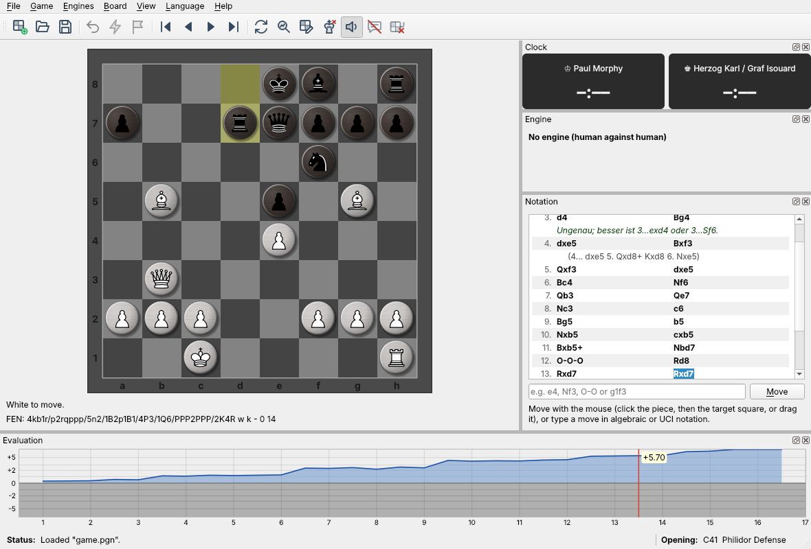
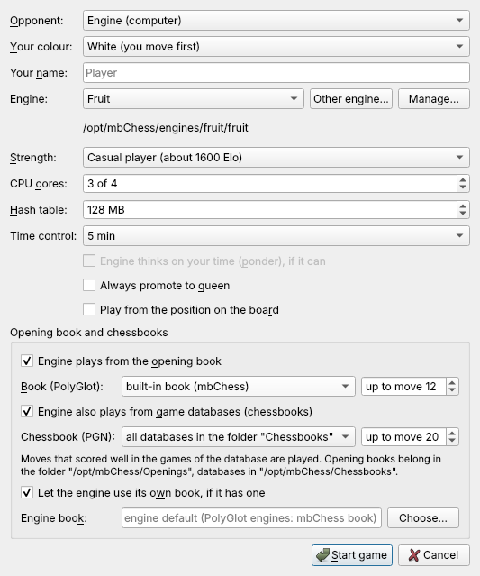
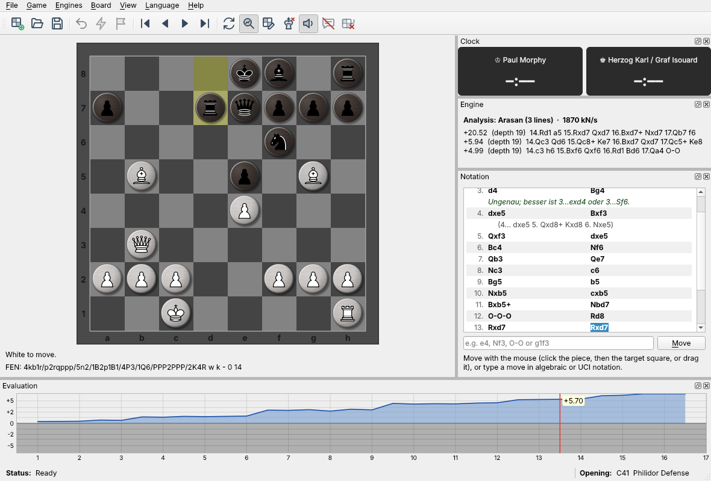
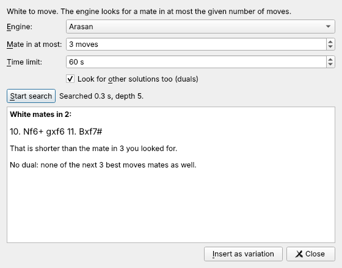
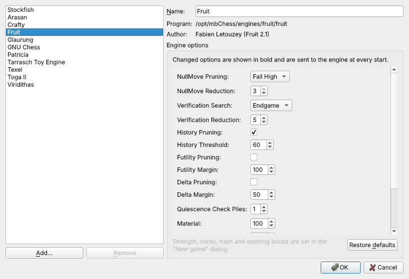
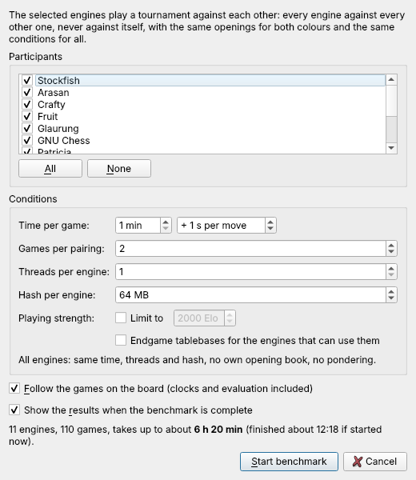
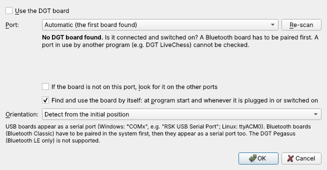

# Welcome to mbChess

mbChess is a free chess program for Windows, Linux and macOS (Android will follow). You can
play against strong chess engines, replay and analyse games, set up positions, let an engine
look for mates, let engines play each other and play on an electronic DGT board.

At a glance:

- **Play** against an engine, against a human on the same board, or watch engine against
  engine, with a chess clock, adjustable strength, opening book and chessbooks.
- **Engines included**: Stockfish, Arasan, Fruit, Toga II, Glaurung, GNU Chess, Viridithas,
  Texel, Patricia and the Tarrasch Toy Engine.
  More UCI engines can be added.
- **Analysis** with an engine, evaluation graph, variations and comments.
- **Game databases** in PGN format, even with tens of thousands of games.
- **Board editor** and **mate search**.
- **Engine benchmark**: a round-robin tournament of the engines under equal conditions.
- **Endgame tablebases**: Syzygy to download, Gaviota with the distance to mate in the analysis.
- **DGT boards** via USB or Bluetooth.
- Hundreds of **boards and piece sets**, move sounds and **move announcements** in English or
  German.

mbChess is free software under the GNU General Public License, version 3 or later. It comes
without any warranty.

# Installation and start

## Windows

Run the installer `mbChess-<version>-en-setup.exe` (English) or
`mbChess-<version>-de-setup.exe` (German). The wizard suggests the folder `C:\mbChess` and
offers these components:

| Component | Contents | Default |
| --- | --- | --- |
| mbChess | the program with help (CHM), boards, pieces and sounds | always |
| UCI chess engines | the included engines, each one can be deselected | on |
| Voice recorder | program to record your own move announcements | off |
| Manual (PDF) | this manual as a PDF file | off |

An existing installation is replaced. Uninstall mbChess with "Settings → Apps" or with
"Uninstall mbChess" in the Start menu, where you also find "mbChess help".

## Linux and macOS

On Linux and macOS mbChess is currently built from the source code (Qt 6.4 or newer, Qt 5.15
on macOS Catalina). The instructions are in the file `README.md` of the source code. The
result is in the folder `bin` of the build folder.

## The start screen

At start mbChess shows a start screen with the version number, the part being loaded
(settings, boards and pieces, engines and books, looking for a DGT board) and a progress bar.
Switch it off and on with **View → Show the start screen**.

## Command line

| Call | Effect |
| --- | --- |
| `mbchess game.pgn` | opens the PGN file |
| `mbchess --fen "<FEN>"` | puts the position from the FEN on the board |

# The main window

The main window has the board in the middle and several windows around it. Each of these
windows can be moved, docked at another edge, left floating or closed. Switch them on again in
the **View** menu; **View → Reset window layout** restores the original layout. mbChess saves
size, position and layout by itself.

| Window | Contents |
| --- | --- |
| **Board** | the position; below it the state of the game and the FEN of the position |
| **Clock** | the players' names and their time; the side to move is highlighted |
| **Engine** | what the engine is calculating: depth, evaluation, main line, speed |
| **Notation** | the moves of the game with variations and comments, below it the move input |
| **Evaluation** | the evaluation graph of the game |
| **Games** | the game list of an open database |

## The status bar

The status bar at the bottom is divided into sections:

- **Status:** general messages, for example "Game saved" or "Book move". Without a message it
  shows "Ready".
- **Chessbook:** progress while a chessbook is read (only while reading).
- **Opening:** the ECO code and the name of the opening.
- **Benchmark:** progress of a running engine benchmark with a button to cancel it.
- **DGT:** the state of the DGT board, for example "✓ matches the game" or "please play Nf6 on
  the board".

Text that is too long is shortened with "…"; the tooltip shows it in full.

## The toolbar

From left to right the toolbar holds: New game, Open game, Save game, Take back move, Move
now, Resign, go to the start, move back, move forward, go to the end, Flip board, Engine
analysis, Set up position, Mate search, Move sounds, Announce moves and DGT board. The icons
for move sounds, announcements and the DGT board show whether the function is on or off.

# Playing a game

## New game

**File → New game** (Ctrl+N) opens the dialog for a new game.

| Setting | Meaning |
| --- | --- |
| **Opponent** | Engine (computer), Human (both sides on this board) or Engine against engine |
| **Your colour** | White, Black or Random |
| **Your name** | shown at the clock and in the saved PGN |
| **Engine** | the opponent. "Other engine…" picks a program file, "Manage…" opens the engine list |
| **Strength** | from "Beginner (about 1350 Elo)" to "Full strength" |
| **CPU cores**, **Hash table** | computing power and memory of the engine |
| **Engine thinks on your time (ponder)** | the engine already searches while you think, on the move it expects from you. If you play it, it answers faster and better. Only at full strength and with engines that can do it (Stockfish, Arasan, Texel, Fruit, Toga II, Glaurung, GNU Chess) |
| **Time control** | "No clock" or a time with increment, for example 5 min + 3 s |
| **Always promote to queen** | a pawn on the last rank becomes a queen without asking |
| **Play from the position on the board** | the game starts from the position set up instead of the initial position |
| **Opening book and chessbooks** | see the chapter "Opening books and chessbooks" |

With "Engine against engine" you choose one engine for White and one for Black, and watch.

## Making moves

You have several ways:

- **Click**: click the piece, then the target square.
- **Drag**: drag the piece onto the target square.
- **Type**: type the move into the field below the notation and press Enter, in algebraic
  notation (`e4`, `Nf3`, `O-O`, `exd5`, `e8=Q`) or in UCI notation (`g1f3`).
- **DGT board**: make the move on the electronic board (chapter "DGT board").

On a promotion mbChess asks for the piece, unless "Always promote to queen" is on.

## During the game

| Command | Key | Effect |
| --- | --- | --- |
| Game → Take back move | Ctrl+Z | takes back your last move (and the engine's reply) |
| Game → Move now! | Space | the engine has to move at once |
| Game → Resign | – | gives up the game |
| Board → Flip board | Ctrl+R | turns the board round |

During the game you can step back with the arrow keys. Moves are made only at the end of the
game, though; the End key takes you back there.

The game ends with checkmate, stalemate, threefold repetition, the fifty-move rule,
insufficient material, loss on time or resignation. Then the board becomes an analysis board:
you can try moves and switch on the engine analysis.

Commands that would end a running game (a new position, the board editor, the mate search, a
benchmark on the board, quitting the program) ask first.

# Opening and saving games

## PGN files

**File → Open game (PGN)** (Ctrl+O) reads a PGN file with variations, comments, symbols ($1,
$2 …) and evaluations (`[%eval]`). **File → Save game as PGN** (Ctrl+S) writes the game with
its variations, comments and the engine's evaluations.

If the game holds moves, variations or comments that are not saved yet, mbChess asks before
they are lost (on quitting, a new game, opening another game, a new position) and offers
**Save game…**.

## Game databases

If the file holds several games, the window **Games** shows a list: number, White, Elo, Black,
Elo, result, moves, ECO, date, event, site and round. Click a column header to sort; the search
field filters by player, event, site, ECO or year. Double click or Enter loads a game.
**File → Previous game** (Ctrl+PgUp) and **Next game** (Ctrl+PgDown) step through the
(filtered) list.

mbChess reads large files (60,000 games and more) in the background; you can go on working
meanwhile.

## FEN

**File → Set position from FEN** puts a position from a FEN line on the board, **File → Copy
FEN** copies the FEN of the current position to the clipboard. The FEN is also always shown
below the board.

# Notation, variations and comments

The notation shows one move per line (number, White, Black). Comments are in italics on their
own lines, variations indented in brackets.

| Action | Effect |
| --- | --- |
| Click a move | goes to this position |
| ← / → | one move back / forward |
| Home / End | to the start / to the end |
| Click into the evaluation graph | goes to this move |

Outside a running game, a move in the middle of the game becomes a new variation. The context
menu (right mouse button) of a move offers:

- **Promote variation**: the variation becomes the main line.
- **Delete from here**: removes the move and everything after it.
- **Edit comment…**: write or change the comment after the move.

# Analysis

## Engine analysis

**Engines → Engine analysis** (Alt+F2) lets an engine search the position on the board without
a time limit. The engine window shows the evaluation, depth and main line of every line. The
analysis follows every move and every step through the game.

- **Engines → Analysis engine** chooses the engine.
- **Engines → Analysis lines** sets 1 to 5 lines (MultiPV). Some engines show only one line.

The evaluation of the best line is stored at the move; it appears in the evaluation graph and
in the saved PGN. During a running game against an engine or with a clock the analysis is
locked.

## Reading evaluations

Evaluations are from White's point of view, in pawn units: +1.00 means White is about a pawn
better; −0.50 means Black is slightly better. "#3" means mate in three moves for White, "#−3"
for Black.

# Setting up a position

**Game → Set up position** (Ctrl+E) opens the board editor with an empty board.

- **Place pieces**: drag a piece from the bar at the top (Black) or bottom (White) onto the
  board, or click the piece and then click as many squares as you like.
- **Move**: drag pieces on the board; hold Ctrl to copy.
- **Remove**: drag the piece off the board or right-click it.
- **Clear board** and **Initial position** reset the board, **Current position** brings the
  position of the running game into the editor.

On the right you set who is to move (White, Black or "Decided by the program": the side in
check, otherwise White), the castling rights, the en passant square and the move number. In
the FEN line at the bottom you can also type or paste a FEN and apply it with Enter. **Load
position…** and **Save position…** read and write `.fen` files.

mbChess checks the position all the time (kings, pawns on the back ranks, check of the side not
to move) and shows the result below the FEN. **Apply** puts the position into the main window
as an analysis board; "New game" then offers **Play from the position on the board**.

# Mate search

**Engines → Mate search** (Ctrl+M) looks for a mate in the position on the board.

| Setting | Meaning |
| --- | --- |
| **Engine** | Stockfish by default, which has its own mate search |
| **Mate in at most** | the number of moves |
| **Time limit** | how long the search may take at most |
| **Look for other solutions too (duals)** | checks whether other moves mate as well (slower, only engines with MultiPV) |

**Start search** begins the search. mbChess shows the solution, whether there is a shorter
mate and whether other solutions exist. **Insert as variation** adds the solution to the game;
step through it with the right arrow key.

# Engines

## Included engines

| Engine | Strength | Notes |
| --- | --- | --- |
| Stockfish | one of the strongest engines | neural network, mate search, Syzygy |
| Arasan | very strong | Syzygy, own book |
| Viridithas | very strong | neural network, Syzygy |
| Texel | very strong | neural network, Syzygy and Gaviota, adjustable strength |
| Patricia | strong, very aggressive | neural network, Syzygy, adjustable strength |
| Toga II, Fruit | medium to strong | classic, PolyGlot book |
| Glaurung | medium to strong | classic |
| GNU Chess | medium | own book |
| Tarrasch Toy Engine | weak | small and simple, good for beginners |

Crafty is not included because its licence forbids redistribution. If you build it yourself,
put it into the folder `engines` next to the program.

## Managing engines

**Engines → Manage engines** shows all engines. Engines in the folder `engines` next to the
program are always in the list.

- **Add…** adds another UCI engine (choose the program file).
- **Remove** takes it off the list; the file stays where it is.
- **Name** changes the name shown.
- **Engine options** shows all options the engine reports. Changed options are shown in bold
  and are sent to the engine at every start. **Restore defaults** resets them.

Strength, cores, hash and opening books are set in the "New game" dialog.

# Opening books and chessbooks

In the "New game" dialog you decide where the engine takes its opening moves from.

- **Engine plays from the opening book**: a book in PolyGlot format (`.bin`), up to a move
  number you choose. A book made from the named openings is built in. Put more books into the
  folder `Openings` next to the program.
- **Engine also plays from game databases (chessbooks)**: mbChess reads a PGN database (or all
  of them in the folder `Chessbooks`) and plays moves that scored well in these games, much like
  Crafty does with its books.
- **Let the engine use its own book**: Fruit, Toga, GNU Chess and Arasan have their own books.

When the engine plays a book move, "Book move: …" is shown in the engine window.

# Endgame tablebases

Syzygy endgame tablebases hold the perfect result of every position with few pieces. Engines
that can read them (Stockfish, Arasan, Viridithas, Texel, Patricia, Crafty) play such endgames
without a flaw.

**Engines → Endgame tablebases** shows how many tables are there and downloads the
tables with 3, 4 and 5 pieces: results only (WDL, about 378 MB) or also the distance to the next
pawn move or capture (WDL + DTZ, about 939 MB, recommended). A cancelled download can be
continued later. The folder is `Syzygy` next to the program and can be changed.

**Gaviota tables** (files `*.gtb.cp4`) also hold the number of moves to mate. Put them into the
folder `Gaviota` next to the program or choose another folder in the same dialog; mbChess does
not download them itself (3–5 pieces, about 6.5 GB). Texel uses them when playing, and in the
analysis (no engine opponent, no clock) mbChess shows the result of positions with up to 5
pieces in the status line, for example "Tablebase: White mates in 9 moves." During a game this
hint is not shown.

# Engine benchmark

**File → Benchmarks → Engine tournament** lets the selected engines play a round-robin
tournament: every engine against every other one, with the same openings for both colours and
equal conditions.

| Setting | Meaning |
| --- | --- |
| **Participants** | the engines (at least two) |
| **Time per game** | for example 5 min + 3 s per move |
| **Games per pairing** | with an even number every opening is played with both colours |
| **Threads**, **Hash** | the same for all; one thread is the fairest comparison |
| **Limit playing strength** | all engines at the same Elo |
| **Endgame tablebases** | off by default, because they help only some engines |
| **Follow the games on the board** | the board shows the running game with clocks and evaluation |

Before the start mbChess shows the expected duration. The progress is in the status bar;
cancel with the button next to it or with **File → Benchmarks → Cancel benchmark**. If a game
is running and you want to follow the benchmark on the board, mbChess asks first, because the
game is ended then.

While the benchmark runs, the board and the engines belong to it: New game, opening games,
Set up position, Paste FEN, Mate search, taking the position from the DGT board and Manage
engines are greyed out until it is finished or cancelled.

**File → Benchmarks → Show results** shows the table (the winner is highlighted) and all games
with their duration; the games can be saved as PGN.

# DGT board

mbChess plays with electronic boards from DGT connected via USB or Bluetooth Classic. The
boards appear in the system as a serial port (Windows "COMx", Linux `ttyACM0` or `rfcomm0`).
Bluetooth boards have to be paired in the system first. The DGT Pegasus (Bluetooth LE only) is
not supported.

## Setting up

**Board → DGT board settings…** looks for a board at once when it opens and shows on which port
it answers, with name, version and the position on the board.

- **Port**: "Automatic (the first board found)" or a particular port. **Re-scan** looks again.
- **Look for it on the other ports**: if the board is not on the chosen port, the others are
  checked.
- **Find and use the board by itself**: at program start and whenever the board is plugged in
  or switched on.
- **Orientation**: "Detect from the initial position" (set up the initial position, mbChess
  sees which way round the board lies) or fixed.

## Playing

**Board → Use the DGT board** (Ctrl+D, toolbar) switches the board on and off. The check mark and
the icon show a connected board; if none was found, a click searches again, and mbChess connects
anyway as soon as the board is plugged in or switched on. Make your moves
on the board: as soon as the board is still for a moment and exactly one legal move fits, it
is played. The status bar shows the engine's move ("DGT: please play Nf6 on the board"); make
it on the board. "✓ matches the game" confirms that board and game agree; otherwise it says on
how many squares they differ.

**Board → Take the position from the DGT board…** opens the board editor with the pieces
standing on the board.

If the board is switched off or unplugged, mbChess says so and connects again as soon as it
answers.

During an engine benchmark and an engine-against-engine game the board pauses: moves on it are
ignored and the status bar shows "DGT: paused …". Afterwards it works again by itself.

# Boards, pieces, sounds and language

## Board and pieces

In the **Board** menu, **Board style** and **Pieces** offer many themes: the grey mbChess
board with pieces on wooden discs, the wooden board "mbChess (classic)", the boards and pieces
of AmiChess and more than 170 boards and about 50 piece sets from Lucas Chess. **Show
coordinates** shows the letters and numbers at the edge. Put your own themes into the folder
`themes` next to the program.

## Sounds and announcements

**Board → Move sounds** and **Board → Announce moves** switch sounds and announcements on and
off, as do the two icons in the toolbar. **Board → Voice** chooses the voice: automatic by
program language, German (Thorsten), English (LibriTTS), English (AmiChess original) or a voice
you recorded yourself. Record your own voice word by word with the program **mbChess voice
recorder**.

## Window theme and language

**View → Window theme** chooses between "System" and "Dark design". The **Language** menu
switches between English and German, including the piece letters in the notation (K Q R B N or
K D T L S).

# Keyboard shortcuts

| Key | Command |
| --- | --- |
| Ctrl+N | New game |
| Ctrl+O | Open game (PGN) |
| Ctrl+S | Save game as PGN |
| Ctrl+Q | Quit |
| Ctrl+PgUp / Ctrl+PgDown | Previous / next game of the database |
| Ctrl+Z | Take back move |
| Space | Move now! |
| Ctrl+E | Set up position |
| Ctrl+M | Mate search |
| Alt+F2 | Engine analysis on/off |
| Ctrl+R | Flip board |
| Ctrl+D | Use the DGT board on/off |
| Home / ← / → / End | to the start / back / forward / to the end |
| F1 | this manual |

# Files and folders

Next to the program (on Windows usually `C:\mbChess`) are these folders:

| Folder | Contents |
| --- | --- |
| `engines` | the engines, one per subfolder; put new engines here |
| `Openings` | opening books in PolyGlot format (`*.bin`) |
| `Chessbooks` | game databases (`*.pgn`) for the chessbooks |
| `Syzygy` | endgame tablebases (Syzygy) |
| `Gaviota` | endgame tablebases (Gaviota) |
| `themes` | your own boards and piece sets |
| `Manual` / `Handbuch` | this manual (CHM on Windows, PDF) |

mbChess stores its settings on Windows in the registry
(`HKEY_CURRENT_USER\Software\mbChess`), on Linux in `~/.config/mbChess/mbChess.conf` and on
macOS in `~/Library/Preferences/com.mbchess.mbChess.plist`.

# Troubleshooting

**The engine does not start.** Check in **Engines → Manage engines** whether the engine
answers. An engine has to speak the UCI protocol; pure XBoard engines are not supported.

**I cannot move.** During a game moves are made only at the end (End key). If the engine is to
move, wait or press Space. While you follow a benchmark your own moves are locked.

**The DGT board is not found.** Is it connected and switched on? A Bluetooth board has to be
paired. mbChess cannot check a port that another program (such as DGT LiveChess) uses; close
the other program.

**There are no sounds.** Check **Board → Move sounds**. Versions built without Qt Multimedia
are silent.

**The window layout is a mess.** **View → Reset window layout**.

# Licence and thanks

mbChess © Michael Bergmann 2026, free software under the GNU General Public License, version 3
or later. The licence text is in the file `LICENSE.txt` in the program folder.

mbChess uses Qt (The Qt Company, LGPL) and material of many free projects: the "cburnett"
pieces by Colin M.L. Burnett, boards and pieces from AmiChess and Lucas Chess, the voice
"Thorsten" by Thorsten Müller, the "LibriTTS" voice, the opening names of lichess.org and the
engines Stockfish, Arasan, Fruit, Toga II, Glaurung, GNU Chess, Viridithas, Texel, Patricia and
the Tarrasch Toy Engine with their authors, and the Gaviota probing code by Miguel A. Ballicora. The full list is in the file `CREDITS.md` of the source code.

Many thanks to DGT for the description of the board protocol.
